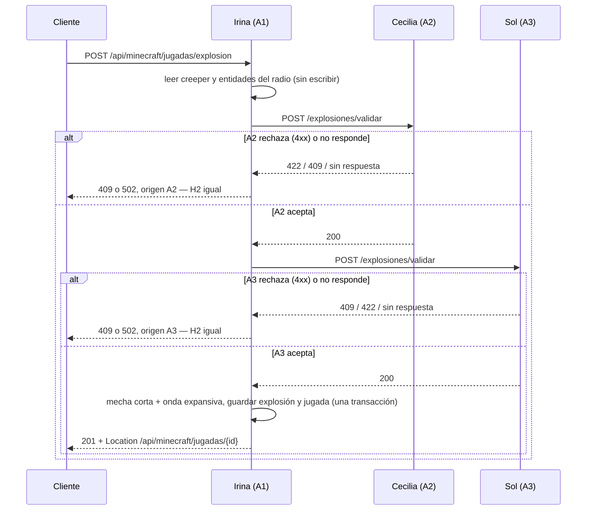
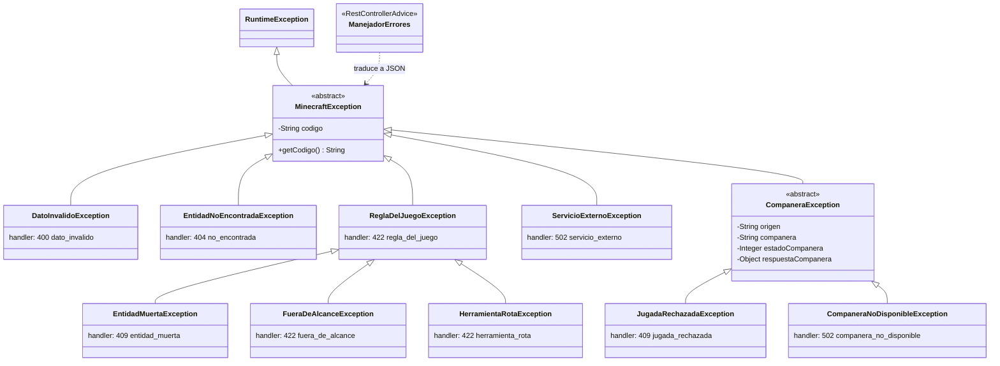

# ii-taller-git-2026

- **Nombre:** Irina Insfrán
- **GitHub:** [IrinaInsfran](https://github.com/IrinaInsfran)
- **Materia:** Lenguaje de Programación 3 — Sección F
- **Ejercicio:** POO-09 — APIs cruzadas: OpenAPI, consumo de A2 y A3 y escenario guardado (dominio **Minecraft**)
- **Licencia:** [Apache License 2.0](LICENSE)
- **Commit de la solución (POO-09):** el enlace exacto está en el archivo de entrega, [docs/ENTREGA-POO-09.md](docs/ENTREGA-POO-09.md).
- **Commit de POO-08 (corregido):** [fed74e9](https://github.com/IrinaInsfran/ii-taller-git-2026/commit/fed74e97a1981e062f8c4a548e69bd91bd1e46c5); la corrección está en [la sección de abajo](#corrección-de-poo-08-observaciones-cerradas).
- **OpenAPI:** `http://100.87.95.24:8082/v3/api-docs` (JSON) y `http://100.87.95.24:8082/swagger-ui.html` (navegador). En la misma máquina, `localhost` en lugar de la IP.
- **Bitácora de uso de IA:** [BITACORA.md](BITACORA.md)
- **Especificaciones (Classroom):** [docs/ESPECIFICACIONES-POO-08.md](docs/ESPECIFICACIONES-POO-08.md)
- **Colecciones Insomnia:** [POO-09](insomnia/minecraft-poo09-insomnia.json) (escenario y rechazos, con [respuestas de ejemplo](insomnia/respuestas-poo09/)) y [POO-08](insomnia/minecraft-poo08-insomnia.json)

API REST en Spring Boot 4 / Java 21 que guarda el mundo de Minecraft en una base
**H2**: un CRUD de entidades (jugadores, mobs, aldeanos, animales), un protocolo
de dominio (`Amenaza`), una **simulación de explosiones de creeper** con dos
reglas del juego y una jerarquía de excepciones con un *handler* HTTP por tipo.

## POO-09: APIs cruzadas

### Grupo y reglas de cada una

Cada una es A1 de su propia entrega y consulta a las otras dos. Las tres se conectan por
**Tailscale**, así que las IPs son fijas aunque cambie la red.

| Integrante | Rol en mi entrega | URL (Tailscale) | OpenAPI | Regla que uso | Respuestas |
|---|---|---|---|---|---|
| Irina Insfrán ([repo](https://github.com/IrinaInsfran/ii-taller-git-2026)) | **A1** | `http://100.87.95.24:8082` | [`/v3/api-docs`](http://100.87.95.24:8082/v3/api-docs) | 1) **Mecha corta:** un creeper vivo solo detona si hay un jugador vivo a 3 bloques o menos, y apunta al más cercano. 2) **Onda expansiva:** daña a cada entidad viva del radio (6 bloques), más cuanto más cerca. | Mi regla 1 también está publicada para ellas en `POST /api/minecraft/reglas/mecha-corta`: 200, 422 `fuera_de_alcance`, 409 `entidad_muerta`. |
| Cecilia Basualdo ([repo](https://github.com/CeciBasu/clbasualdo-taller-git-2026)) | **A2** | `http://100.122.114.103:8083` | [`/v3/api-docs`](http://100.122.114.103:8083/v3/api-docs) | `POST /explosiones/validar`: 1) un creeper solo detona si está vivo; 2) un creeper solo detona una vez. Lee `saludCreeper` y `yaDetonado`. | 200 acepta; 422 `CreeperMuertoException`; 409 `CreeperYaDetonadoException`. |
| María Sol Ferreira ([repo](https://github.com/MariaSol45/msferreira-tplp3-2026)) | **A3** | `http://100.87.131.50:8080` | [`/v3/api-docs`](http://100.87.131.50:8080/v3/api-docs) | `POST /explosiones/validar`: 1) el creeper no detona antes de su tiempo (`tiempoTranscurrido >= tiempoExplosion`); 2) cada objetivo tiene que estar dentro de `radioExplosion`. | 200 acepta; 409 «explosión no preparada»; 422 objetivo fuera del radio. |

### Escenario: «el creeper pide permiso»

**En una oración:** un creeper guardado en mi H2 intenta explotar; antes de tocar la base
le pregunto a Cecilia si está vivo y no detonó y a Sol si ya pasó su tiempo de mecha y los
alcanzados están dentro del radio, y solo si las dos aceptan aplico mis reglas (mecha corta y
onda expansiva) y guardo la explosión, el daño y la jugada.

```bash
curl -X POST http://localhost:8082/api/minecraft/jugadas/explosion \
  -H "Content-Type: application/json" -d '{"creeperId": 2, "tiempoTranscurrido": 30}'
```

1. **Leer sin escribir.** `JugadaServiceImpl` busca el creeper y las entidades vivas a 6
   bloques o menos. Si no hay nadie en el radio, responde 422 sin consultar a nadie: no hay
   jugada que validar.
2. **Un cuerpo para las dos.** `ValidacionCompaneraRequest` lleva lo que usa cada una:
   `saludCreeper` y `yaDetonado` (si ese creeper ya tiene una explosión guardada) para
   Cecilia; `tiempoExplosion`, `tiempoTranscurrido`, `radioExplosion`, la posición del creeper
   y los `objetivos` para Sol. Cada una ignora lo que no usa.
3. **A2 y después A3, en serie** (`CeciReglasClient` y `SolReglasClient`). Si Cecilia
   rechaza, a Sol no se le pregunta: el rechazo tiene un solo origen.
4. **Escribir al final, en una transacción.** Con las dos de acuerdo, `ExplosionService`
   aplica mis dos reglas y se guarda la `Jugada` con lo que contestó cada una. Si mi regla
   rechaza (ningún jugador a 3 bloques), la transacción se deshace entera.

Las llamadas HTTP quedan **fuera** de la transacción: cuando una compañera rechaza todavía no
se escribió nada, y no queda una conexión a la base abierta mientras se espera a otra API.



| Caso | HTTP | Cuerpo |
|---|---|---|
| A2 y A3 aceptan y mi regla también | 201 | `JugadaResponse`: `a2` y `a3` con lo que contestó cada una (rol, nombre, URL, código y cuerpo) y la `explosion` con el daño a cada entidad. |
| A2 o A3 rechaza (4xx) | 409 | `ErrorCompaneraResponse`: `error: jugada_rechazada`, `codigo: rechazada_por_a2` o `rechazada_por_a3`, `origen`, `companera`, `estadoCompanera` y `respuestaCompanera` (su cuerpo, sin modificar). |
| A2 o A3 no responde, se vence el tiempo o devuelve 5xx | 502 | `ErrorCompaneraResponse` con `codigo: companera_no_disponible` y el `origen`. |
| Mi regla rechaza: nadie en el radio o ningún jugador a 3 bloques | 422 | `ErrorResponse` con `codigo: fuera_de_alcance`. |
| Mi regla rechaza: el creeper ya está muerto | 409 | `ErrorResponse` con `codigo: entidad_muerta` (solo si A2 lo aceptara). |
| Falta un dato / no existe el creeper / no es un creeper | 400 / 404 / 422 | `ErrorResponse`; no se consulta a nadie. |

Ejemplo real de rechazo de Cecilia (el creeper 2 ya había explotado):

```json
{
  "error": "jugada_rechazada", "codigo": "rechazada_por_a2", "origen": "A2", "companera": "Cecilia",
  "estadoCompanera": 422,
  "respuestaCompanera": {"status": 422, "error": "Unprocessable Entity", "tipo": "CreeperMuertoException",
                         "mensaje": "Creeper no puede detonar: está muerto."},
  "mensaje": "Cecilia (A2) rechazó la jugada: Creeper no puede detonar: está muerto. La jugada no se guardó."
}
```

**¿Qué queda igual si A2 acepta y A3 rechaza?** Todo lo de mi H2: no se crea la explosión ni
la jugada y nadie recibe daño. Lo comprueban `JugadaControllerTest` (`siSolRechazaNoCambiaNada`,
`siCeciRechazaNoSeConsultaASolYNoCambiaNada`, `siUnaCompaneraNoRespondeDevuelve502`) y las
carpetas 3 y 4 de Insomnia, que después del rechazo listan las jugadas y las explosiones.

### Cómo levantar los tres servicios

Primero A2 y A3, que no dependen de nadie para responder sus reglas; después A1. Cada una en su
máquina, conectada a Tailscale:

```bash
# Cecilia (A2), en su repositorio, rama poo-09-apis-cruzadas
cd minecraft && ./mvnw spring-boot:run        # puerto 8083

# Sol (A3), en su repositorio, rama feature/poo-09-apis-cruzadas
cd minecraft && ./mvnw spring-boot:run        # puerto 8080

# Irina (A1), en este repositorio
./mvnw spring-boot:run                        # puerto 8082
```

Para comprobar que cada una llega a las otras: `GET /v3/api-docs` de las tres tiene que dar 200, y
`GET /api/minecraft/jugadas/companeras` muestra a quién consulta mi escenario.

Las URLs de A2 y A3 no están en el código: por defecto son las de Tailscale y se cambian con
variables de entorno. Por ejemplo, si las tres corren en la misma máquina:

```bash
CECI_URL=http://localhost:8083 SOL_URL=http://localhost:8080 ./mvnw spring-boot:run
```

## Corrección de POO-08: observaciones cerradas

POO-08 sacó 20/24 (documento «Corrección POO-08 - Irina Insfrán»). Tenía dos
observaciones que restaban puntos y dos mejoras sugeridas. Todas quedaron cerradas:

| # | Observación | Estado | Cómo se cerró |
|---|---|---|---|
| 2 | **Organización en paquetes (2/3):** el dominio lanzaba excepciones y tenía la lógica de negocio; las dos reglas vivían en `Creeper.elegirObjetivo`, `Creeper.explotarCercaDe` y `Explosion.detonar`. | Cerrada | Las validaciones, las reglas y las excepciones pasaron a la capa `service`. Las clases de `domain` solo guardan el estado encapsulado: ningún archivo de `domain` importa `py.edu.uc.lp3.exceptions` ni tiene un `throw` (se puede comprobar con `grep -rn "throw\|exceptions" src/main/java/py/edu/uc/lp3/domain`). El detalle, en la tabla de abajo. |
| 8 | **Documentación (0/3):** más de tres errores de ortografía en el README, el Javadoc y los comentarios (`dia`, `polimorfico`, `Simulacion`, `explosion`, `nada en comun`, `le haria`, `esta lejos`...). | Cerrada | Se corrigieron los señalados y se revisó todo el texto entregado: README, bitácora, `docs/`, Javadoc, comentarios, mensajes de error, descripciones de OpenAPI y comentarios de `application.properties` y `log4j2-spring.xml`. La revisión se hizo con el diccionario de español (hunspell `es_PY`) y, para las palabras que llevan tilde según el sentido (esta/está, que/qué, como/cómo, más/mas, pasados como «quedó» o «aplicó»), leyendo cada caso. |
| 8 | Mejora: frase suelta «Ahora un creeper se crea con POST /api/minecraft/entidades» debajo de la tabla de endpoints. | Cerrada | Se borró: los ejemplos de creación están en «Ejemplo: crear con el constructor completo o con el sobrecargado». |
| 4 | Mejora: `HerramientaRotaException` no tenía handler propio. | Cerrada | `ManejadorErrores.herramientaRota` responde 422 con `error: herramienta_rota`, así el cliente la distingue de las demás reglas. |
| 7 | Mejora: dos commits de documentación sin el prefijo `docs:`. | Cerrada en los commits nuevos | Esos commits ya están en `main` a través del pull request y reescribirlos cambiaría su hash. Todos los commits nuevos llevan su prefijo de *semantic commits* (`refactor:`, `docs:`, `feat:`, `test:`...). |

**Adónde fue cada cosa que estaba en el dominio:**

| Antes, en `domain` | Ahora, en `service.impl` |
|---|---|
| Validaciones de los constructores de `Entidad`, `EntidadHostil`, `Jugador`, `Creeper`, `Aldeano` (salud, velocidad, posición, rango, daño, mecha, nombre, profesión, experiencia) | `EntidadServiceImpl.validar`, que revisa la entidad recién construida en el POST y en el PUT |
| Reglas del PUT en `Entidad.reemplazarCon` (no cambiar de tipo, no editar a un muerto) | `EntidadServiceImpl.validarReemplazo`; `reemplazarCon` solo copia el estado |
| Regla 1, `Creeper.elegirObjetivo` / `puedeDetonarCerca` | `ReglasCreeperServiceImpl.mechaCorta` |
| Regla 2, `Explosion.detonar` / `calcularDano` | `ReglasCreeperServiceImpl.ondaExpansiva` / `calcularDano`; `Explosion.registrarDetonacion` solo anota el resultado |
| `Creeper.explotarCercaDe` / `explotar` | `ReglasCreeperServiceImpl.explotarCercaDe` / `explotar` |
| `Entidad.mover`, `recibirDano`, `curar` con sus controles; `EntidadHostil.atacar`, `Jugador.atacar` (con arma), `EntidadPasiva.huir`, `Zombie.infectaAldeano`, `Aldeano.comercio`, `Animal.montar`, `Jugador.ganarExperiencia` | `AccionServiceImpl` (los mensajes del dominio quedan, pero sin validar ni lanzar: la salud se mantiene entre 0 y el máximo) |
| `Herramienta.desgastar` / `verificarQueNoEsteRota`, `Espada.atacar`, `Hacha.atacar` / `talar`, `Pico.minar` / `puedeObtener` | `HerramientaServiceImpl` |
| `Esqueleto.dispararFlecha`, `Jugador.construir` / `craftear` / `interactuar` (solo controlaban que estuviera vivo e imprimían) | Se quitaron: el control de que la entidad esté viva lo hace el servicio que la usa. |

Las pruebas siguieron el mismo camino: las del dominio (`EntidadTest`,
`SimulacionYProtocoloTest`, `HerramientaTest`) solo comprueban el estado, y
las de reglas y excepciones están en `ReglasCreeperServiceImplTest`,
`AccionServiceImplTest`, `HerramientaServiceImplTest`, `EntidadServiceImplTest`
y `ExcepcionesTest`. La API responde igual que antes (mismos códigos y
mensajes), salvo un cambio: en `GET /entidades/{id}/amenazas` el creeper ahora
amenaza con su `danoAtaque` y no con el daño de la explosión, porque esa
cuenta es la regla 2 y ya no está en el dominio.

## Cómo arrancar

```bash
./mvnw spring-boot:run
```

Queda escuchando en `http://localhost:8082`. Los tests (138, con H2 en memoria
para no tocar `./data`):

```bash
./mvnw clean test
```

### Propiedades de H2 (`src/main/resources/application.properties`)

| Propiedad | Valor | Qué hace |
|---|---|---|
| `spring.datasource.url` | `jdbc:h2:file:./data/entidades` | La base es un archivo en `./data/`: los datos sobreviven a un reinicio. `data/` está en `.gitignore`. |
| `spring.datasource.driverClassName` | `org.h2.Driver` | El driver JDBC de H2 (dependencia `com.h2database:h2`). |
| `spring.datasource.username` / `password` | `sa` / vacío | Usuario por defecto de H2; sirve también para entrar a la consola. |
| `spring.jpa.hibernate.ddl-auto` | `update` | Hibernate crea las tablas que faltan y agrega columnas nuevas al arrancar, sin borrar lo guardado. |
| `spring.jpa.open-in-view` | `false` | Las entidades se cargan y se guardan dentro de los servicios (`@Transactional`), no mientras se arma el JSON. |
| `spring.h2.console.enabled` | `true` | Habilita la consola web de H2 (dependencia `spring-boot-h2console`). |
| `spring.h2.console.path` | `/h2-console` | Dónde se abre la consola. |
| `spring.h2.console.settings.web-allow-others` | `true` | Permite abrir la consola desde otra máquina (uso el navegador de Windows con la app en una VM). Solo para desarrollo. |

**Consola H2:** `http://localhost:8082/h2-console` → JDBC URL
`jdbc:h2:file:./data/entidades`, usuario `sa`, sin clave. Se ven las tablas
`ENTIDAD` (toda la familia, con la columna `TIPO_ENTIDAD`) y `EXPLOSION`.

## Paquetes

Siguen el [template de la cátedra](https://github.com/alefq/lp3-template-tp/tree/main/src/main/java/py/edu/uc/lp3).

| Paquete | Qué contiene |
|---|---|
| `py.edu.uc.lp3.domain` | Las clases del juego, que **solo guardan el estado encapsulado**: `Entidad` y su familia, `Explosion`, `Herramienta`, las interfaces `Amenaza` y `Arma`. No validan, no lanzan excepciones y no aplican reglas. No conocen HTTP. |
| `py.edu.uc.lp3.exceptions` | La jerarquía `MinecraftException` (en el template, `lp3exceptions`). |
| `py.edu.uc.lp3.repository` | Interfaces de Spring Data: `EntidadRepository`, `ExplosionRepository`, `JugadaRepository`. Sin lógica. |
| `py.edu.uc.lp3.service` / `service.impl` | **Las validaciones, las reglas del juego y las excepciones**: `EntidadServiceImpl` (invariantes del CRUD), `ReglasCreeperServiceImpl` (las dos reglas de la simulación), `AccionServiceImpl` y `HerramientaServiceImpl` (moverse, atacar, infectar, usar herramientas...). También buscan en el repositorio y guardan. |
| `py.edu.uc.lp3.rest.controller` | Entrada HTTP y `ManejadorErrores`. |
| `py.edu.uc.lp3.client` | Clientes HTTP (WebClient) hacia otras APIs: las reglas de A2 y A3 (`ReglaCompaneraClient`, `CeciReglasClient`, `SolReglasClient`), el mundo de Ceci y la API Minecraft remota. |
| `py.edu.uc.lp3.constants` | `ApiPaths`, las URLs de la API. |
| `py.edu.uc.lp3.dto` | Lo que entra y sale como JSON (`EntidadRequest`, `EntidadResponse`...). Está aparte para que el dominio no tenga anotaciones de Jackson. |

## Endpoints

Base: `http://localhost:8082` (el puerto se cambia con la variable `PORT`). Todas las rutas están en `ApiPaths`.

| Verbo y URL | Qué hace | Éxito |
|---|---|---|
| `GET /` | La app vive. | 200 |
| `POST /api/minecraft/entidades` | Crea una entidad (el JSON trae `tipo`). | 201 + `Location` |
| `GET /api/minecraft/entidades` | Lista lo guardado en H2. | 200 |
| `GET /api/minecraft/entidades/{id}` | Una entidad, o 404. | 200 |
| `PUT /api/minecraft/entidades/{id}` | Reemplaza todos los datos. | 200 |
| `DELETE /api/minecraft/entidades/{id}` | La saca del mundo. | 204 |
| `GET /api/minecraft/entidades/{id}/amenazas[?arma=ESPADA&material=DIAMANTE]` | **Protocolo `Amenaza`**: quién le puede hacer daño a esa entidad y cuánto. | 200 |
| `GET /api/minecraft/comportamientos` | `describirComportamiento()` de cada entidad guardada (polimorfismo). | 200 |
| `POST /api/minecraft/explosiones` (`{"creeperId": 2}`) | **Simulación**: el creeper intenta explotar. | 201 + `Location` |
| `GET /api/minecraft/explosiones` | Historial de explosiones guardadas. | 200 |
| `GET /api/minecraft/explosiones/{id}` | Una explosión, o 404. | 200 |
| `POST /api/minecraft/entidades/{id}/portal[?conservar=true]` | **Integración con el proyecto de Ceci**: la entidad viaja a su mundo (`POST /entidades`). Acá se valida que esté viva y sea JUGADOR, ZOMBIE o CREEPER; allá sus reglas deciden si la aceptan (nombre único, vida ≤ vidaMaxima...). Si entra, sale de este mundo salvo `conservar=true`. Secuencia en [docs/PORTAL.md](docs/PORTAL.md). | 200 (422 si la rechazan, 502 si no responde) |
| `POST /api/minecraft/flechazos` (`{"esqueletoId": 1, "objetivoId": 2}`) | **Integración con otro proyecto**: el esqueleto le dispara al objetivo. Si la flecha llega lo decide la API Minecraft remota (`GET /esqueleto/disparar`, rango 8); el daño (`danoAtaque`) y la muerte los aplica este proyecto. | 200 (502 si la API remota falla) |
| `GET /api/externo/objetos[?id=3&id=5]` | Objetos de [restful-api.dev](https://api.restful-api.dev/objects), consultados con **WebClient**. | 200 (502 si la API externa falla) |
| `GET /api/externo/objetos/{id}` | Un objeto externo, o 404. | 200 |
| `POST /api/minecraft/jugadas/explosion` (`{"creeperId": 2, "tiempoTranscurrido": 30}`) | **Escenario de POO-09**: el creeper explota solo si Cecilia (A2) y Sol (A3) aceptan. Ver [Escenario](#escenario-el-creeper-pide-permiso). | 201 + `Location` (409 si una rechaza, 502 si no responde) |
| `GET /api/minecraft/jugadas` | Jugadas guardadas, la más reciente primero. | 200 |
| `GET /api/minecraft/jugadas/{id}` | Una jugada, o 404. | 200 |
| `GET /api/minecraft/jugadas/companeras` | A quién consulta el escenario y en qué URL. | 200 |
| `POST /api/minecraft/reglas/mecha-corta` | **Regla publicada para otros servicios (POO-09)**: dice si el creeper detona y a qué jugador apunta. No lee ni guarda nada en H2. Detalle abajo. | 200 (409 creeper muerto, 422 nadie cerca) |

### Regla «mecha corta» para otros servicios

`POST /api/minecraft/reglas/mecha-corta` aplica la regla 1 (`ReglasCreeperServiceImpl.mechaCorta`)
sobre entidades armadas en memoria con los datos del cuerpo. El cuerpo es el mismo que el
`/explosiones/validar` de Sol, así se puede reutilizar: los campos de más (`tiempoExplosion`,
`tiempoTranscurrido`, `radioExplosion`) se aceptan y se ignoran.

```json
{
  "saludCreeper": 20,
  "creeper": {"x": 0, "y": 64, "z": 0},
  "objetivos": [
    {"tipo": "jugador", "salud": 20, "posicion": {"x": 2, "y": 64, "z": 0}},
    {"tipo": "aldeano", "salud": 20, "posicion": {"x": 1, "y": 64, "z": 0}}
  ]
}
```

- Solo cuentan los objetivos de `tipo` «jugador» (sin importar mayúsculas) con `salud` mayor que 0.
  Si falta `salud` o `saludCreeper`, la entidad se considera viva.
- **200**: `{"aceptada": true, "regla": "mecha-corta", "objetivo": 0, "distancia": 2.0, "mensaje": "..."}`,
  donde `objetivo` es la posición en la lista del jugador más cercano.
- **422 `fuera_de_alcance`**: ningún jugador vivo a 3 bloques o menos.
- **409 `entidad_muerta`**: `saludCreeper` es 0 o menos.
- **400 `dato_invalido`**: falta `creeper`, la lista `objetivos` está vacía o falta alguna coordenada.

### URLs de las APIs externas (externalizables)

Ninguna URL está fija en el código: cada una sale de una propiedad que toma una variable de entorno y,
si no está definida, usa un valor por defecto.

| Propiedad | Variable de entorno | Por defecto | La usa |
|---|---|---|---|
| `mundo-ceci.base-url` | `MUNDO_CECI_URL` | `http://localhost:8083` | Portal |
| `minecraft-remoto.base-url` | `MINECRAFT_REMOTO_URL` | `http://10.40.142.132:8080` | Flechazos |
| `restful-api.base-url` | — | `https://api.restful-api.dev` | Objetos externos |
| `companeras.a2.base-url` / `companeras.a2.ruta` | `CECI_URL` / `CECI_RUTA` | `http://100.122.114.103:8083` / `/explosiones/validar` | Escenario (A2) |
| `companeras.a3.base-url` / `companeras.a3.ruta` | `SOL_URL` / `SOL_RUTA` | `http://100.87.131.50:8080` / `/explosiones/validar` | Escenario (A3) |
| `companeras.timeout` | `COMPANERAS_TIMEOUT` | `5s` | Escenario |
| `server.port` | `PORT` | `8082` | Este servicio |

```bash
MUNDO_CECI_URL=http://192.168.1.50:8083 ./mvnw spring-boot:run
```

### Logs de integración (Log4j2)

El proyecto usa **Log4j2** en lugar de Logback (`src/main/resources/log4j2-spring.xml`).
Todo loguea en INFO, salvo las clases que hablan con otros servicios, que loguean cada paso
en **DEBUG** por consola y en `logs/integracion.log`:

- `WebClientLogFilter`: cada pedido HTTP saliente (`[mundo-ceci] --> POST ...`, `<-- 200 ... (35 ms)`),
  y en WARN los errores de conexión y los timeouts.
- `MundoCeciClient`, `MinecraftRemotoClient`: qué se manda y qué se recibe.
- `PortalServiceImpl`, `FlechazoServiceImpl`, `ObjetoExternoServiceImpl`: los pasos de cada caso de uso.

Para bajar el nivel sin tocar el XML: `LOGGING_LEVEL_PY_EDU_UC_LP3_CLIENT=INFO ./mvnw spring-boot:run`.

### Documentación OpenAPI / Swagger UI

Con la app levantada, todos los endpoints quedan documentados. La
especificación la genera [springdoc-openapi](https://springdoc.org/) a partir
de los controllers y sus anotaciones `@Tag`, `@Operation` y `@ApiResponse`:

- **Swagger UI:** `http://localhost:8082/swagger-ui.html` — permite probar cada endpoint con *Try it out*.
- **Especificación OpenAPI (JSON):** `http://localhost:8082/v3/api-docs`.

Los errores se documentan con el esquema `ErrorResponse` (`error`, `codigo`, `mensaje`).

### Ejemplo: crear con el constructor completo o con el sobrecargado

```bash
curl -X POST localhost:8082/api/minecraft/entidades -H "Content-Type: application/json" \
  -d '{"tipo":"JUGADOR","salud":20,"posicionX":0,"posicionY":64,"posicionZ":0,"velocidad":4,"nombre":"Steve","nivelEXP":5}'

curl -X POST localhost:8082/api/minecraft/entidades -H "Content-Type: application/json" \
  -d '{"tipo":"CREEPER","posicionX":3,"posicionY":64,"posicionZ":0}'
```

Si el JSON no trae ninguna estadística (salud, velocidad, rango, daño...), el
servicio usa el **constructor sobrecargado** de la clase hija con los valores
del juego; si trae alguna, usa el constructor completo y todas son obligatorias.

## Las dos reglas de la simulación

Participan tres clases persistidas: **`Creeper`**, **`Jugador`** y **`Explosion`**.
Las reglas están en la capa de servicio, en `ReglasCreeperServiceImpl`; las
tres clases solo guardan el estado.

1. **Mecha corta** (`ReglasCreeperServiceImpl.mechaCorta`): un `Creeper` vivo
   solo enciende la mecha si hay un `Jugador` vivo a 3 bloques o menos, y
   apunta al más cercano; si no hay ninguno, no pasa nada
   (`FueraDeAlcanceException`), y si el creeper ya está muerto, tampoco
   (`EntidadMuertaException`).
2. **Onda expansiva** (`ReglasCreeperServiceImpl.ondaExpansiva`): al explotar,
   el `Creeper` muere y la `Explosion` (potencia 3, radio 6) le resta salud a
   **cada** entidad viva del radio, más cuanto más cerca esté (fórmula de
   Minecraft Java en `calcularDano`: 43 en el centro, 16 a 3 bloques, 0 a 6),
   y puede matarla. Una explosión detona una sola vez
   (`ReglaDelJuegoException`, código `explosion_ya_detonada`).

`POST /api/minecraft/explosiones` llega a `ExplosionServiceImpl`, que busca en
el repositorio al creeper, a los jugadores vivos y a todas las entidades, y le
pide a `ReglasCreeperServiceImpl.explotarCercaDe` que aplique las dos reglas.
Después guarda la salud nueva de cada entidad y una fila en `EXPLOSION` con
quién la provocó, cuántas entidades alcanzó y mató, y el daño total
(`Explosion.registrarDetonacion`). Todo va en una transacción: si una regla
falla, no cambia nada.

```json
{
  "id": 1, "creeperId": 2, "jugadorObjetivoId": 1, "jugadorObjetivo": "Steve",
  "potencia": 3.0, "radio": 6.0,
  "entidadesAlcanzadas": 2, "entidadesMuertas": 1, "danoTotal": 40,
  "afectados": [
    {"id": 1, "tipo": "JUGADOR", "distancia": 3.0, "dano": 16, "saludRestante": 4, "murio": false},
    {"id": 3, "tipo": "ALDEANO", "distancia": 2.0, "dano": 24, "saludRestante": 0, "murio": true}
  ]
}
```

## Diagrama

Flechas: `<|--` **herencia**, `<|..` **implementación de interfaz**,
`..>` **uso** (el controller usa el servicio, el servicio usa el repositorio,
el repositorio guarda la entidad). La jerarquía de excepciones está en el
segundo diagrama. Los métodos con `*` son abstractos.

El caso de uso **Portal** (integración con el mundo de Ceci) tiene sus diagramas
de secuencia, con el flujo principal, los errores y los casos no cubiertos, en
[docs/PORTAL.md](docs/PORTAL.md).

```mermaid
classDiagram
    direction TB

    class Amenaza {
        <<interface>>
        +danoContra(Entidad objetivo) int
        +describirAmenaza() String
    }
    class Arma {
        <<interface>>
        +getDanoAtaque() int
        +getDesgastePorGolpe() int
        +estaRota() boolean
        +desgastar(int usos)
    }

    class Entidad {
        <<abstract>>
        -Long id
        -int salud
        -int saludMaxima
        -double posicionX
        -double posicionY
        -double posicionZ
        -int velocidad
        #Entidad()
        +Entidad(int salud, double x, double y, double z, int velocidad)
        +mover(double dx, double dz)
        +mover(double dx, double dy, double dz)
        +recibirDano(int cantidad)
        +curar(int cantidad)
        +morir()
        +reemplazarCon(Entidad nueva)
        #copiarEstadoDe(Entidad otra)
        +estaViva() boolean
        +distanciaA(Entidad otra) double
        +describirComportamiento()* String
    }
    class EntidadHostil {
        <<abstract>>
        -double rangoDeteccion
        -int danoAtaque
        +danoContra(Entidad objetivo) int
        +describirAmenaza() String
    }
    class EntidadPasiva {
        <<abstract>>
        -boolean domesticable
    }
    class Jugador {
        -String nombre
        -int nivelEXP
        +Jugador(String nombre)
        +Jugador(String nombre, double x, double y, double z)
        +Jugador(int salud, double x, double y, double z, int velocidad, String nombre, int nivelEXP)
        +ganarExperiencia(int cantidad)
        +describirComportamiento() String
    }
    class Creeper {
        -int tiempoExplosion
        +Creeper(double x, double y, double z)
        +Creeper(int salud, double x, double y, double z, int velocidad, double rango, int dano, int tiempoExplosion)
        +describirAmenaza() String
        +describirComportamiento() String
    }
    class Zombie {
        +Zombie(double x, double y, double z)
        +describirComportamiento() String
    }
    class Esqueleto {
        +Esqueleto(double x, double y, double z)
        +describirComportamiento() String
    }
    class Aldeano {
        -String profesion
        -boolean infectado
        +Aldeano(double x, double y, double z, String profesion)
        +infectar()
        +describirComportamiento() String
    }
    class Animal {
        -boolean montable
        +Animal(double x, double y, double z)
        +describirComportamiento() String
    }
    class Explosion {
        -Long id
        -double potencia
        -Long creeperId
        -Long jugadorObjetivoId
        -boolean detonada
        -int entidadesAlcanzadas
        -int entidadesMuertas
        -int danoTotal
        #Explosion()
        +Explosion(Creeper creeper, Jugador objetivo)
        +getRadio() double
        +registrarDetonacion(List~Impacto~ impactos)
    }
    class Herramienta {
        <<abstract>>
        -Material material
        -int durabilidad
        +desgastar(int usos)
        +estaRota() boolean
        +describirUso()* String
    }
    class Espada
    class Hacha
    class Pico

    class EntidadRepository {
        <<interface>>
        +existeJugadorConNombre(String nombre, Long idExcluido) boolean
        +buscarJugadoresVivos() List~Jugador~
        +buscarHostilesVivos() List~EntidadHostil~
    }
    class ExplosionRepository {
        <<interface>>
        +findAllByOrderByIdDesc() List~Explosion~
        +findByCreeperId(Long id) List~Explosion~
    }
    class JpaRepository {
        <<interface>>
    }

    class EntidadController
    class AmenazaController
    class ExplosionController
    class EntidadService {
        <<interface>>
    }
    class AmenazaService {
        <<interface>>
    }
    class ExplosionService {
        <<interface>>
    }
    class ReglasCreeperService {
        <<interface>>
        +mechaCorta(Creeper creeper, List~Jugador~ jugadores) Jugador
        +ondaExpansiva(Explosion explosion, List~Entidad~ entidades) List~Impacto~
        +calcularDano(Explosion explosion, double distancia) int
        +explotarCercaDe(Creeper creeper, List~Jugador~ jugadores, List~Entidad~ alrededor) Explosion
    }
    class AccionService {
        <<interface>>
        +mover(Entidad entidad, double dx, double dz)
        +mover(Entidad entidad, double dx, double dy, double dz)
        +atacar(EntidadHostil atacante, Entidad objetivo)
        +atacar(Jugador jugador, Entidad objetivo, Arma arma)
        +huir(EntidadPasiva pasiva, Entidad amenaza)
        +infectar(Zombie zombie, Aldeano aldeano)
    }
    class HerramientaService {
        <<interface>>
        +golpear(Arma arma, Entidad objetivo)
        +talar(Hacha hacha)
        +minar(Pico pico, Mineral mineral) boolean
    }

    Entidad <|-- EntidadHostil
    Entidad <|-- EntidadPasiva
    Entidad <|-- Jugador
    EntidadHostil <|-- Creeper
    EntidadHostil <|-- Zombie
    EntidadHostil <|-- Esqueleto
    EntidadPasiva <|-- Aldeano
    EntidadPasiva <|-- Animal
    Herramienta <|-- Espada
    Herramienta <|-- Hacha
    Herramienta <|-- Pico

    Amenaza <|.. EntidadHostil
    Amenaza <|-- Arma
    Arma <|.. Espada
    Arma <|.. Hacha

    JpaRepository <|-- EntidadRepository
    JpaRepository <|-- ExplosionRepository
    EntidadRepository ..> Entidad : guarda
    ExplosionRepository ..> Explosion : guarda

    EntidadController ..> EntidadService
    AmenazaController ..> AmenazaService
    ExplosionController ..> ExplosionService
    EntidadService ..> EntidadRepository
    AmenazaService ..> EntidadRepository
    AmenazaService ..> Amenaza : habla con
    ExplosionService ..> EntidadRepository
    ExplosionService ..> ExplosionRepository
    ExplosionService ..> ReglasCreeperService : aplica las reglas
    ReglasCreeperService ..> Creeper : mecha corta
    ReglasCreeperService ..> Explosion : onda expansiva
    AccionService ..> HerramientaService
```



### Jerarquía de excepciones y handlers



| Excepción | HTTP | `error` | Cuándo (ejemplos de `codigo`) |
|---|---|---|---|
| `DatoInvalidoException` | 400 | `dato_invalido` | El dato no tiene sentido: `dato_invalido`, `campo_obligatorio`, `nombre_repetido`, `cambio_de_tipo` |
| `EntidadNoEncontradaException` | 404 | `no_encontrada` | El id no existe: `entidad_no_encontrada`, `explosion_no_encontrada` |
| `ReglaDelJuegoException` | 422 | `regla_del_juego` | Los datos están bien pero el juego no lo permite: `solo_creepers_explotan`, `excede_velocidad`, `aldeano_infectado`, `explosion_ya_detonada`... |
| `EntidadMuertaException` | 409 | `entidad_muerta` | Un muerto intenta actuar o se lo quiere editar |
| `FueraDeAlcanceException` | 422 | `fuera_de_alcance` | El objetivo está lejos (ningún jugador a 3 bloques del creeper) |
| `HerramientaRotaException` | 422 | `herramienta_rota` | Se quiere usar una herramienta con durabilidad 0 |
| `ServicioExternoException` | 502 | `servicio_externo` | Otra API (el mundo de Ceci, la API Minecraft remota, restful-api.dev) falló o no respondió |
| `JugadaRechazadaException` | 409 | `jugada_rechazada` | La regla de una compañera rechazó la jugada del escenario: `rechazada_por_a2`, `rechazada_por_a3` |
| `CompaneraNoDisponibleException` | 502 | `companera_no_disponible` | La API de una compañera no respondió, se venció el tiempo o devolvió 5xx |

Todas las respuestas de error tienen la misma forma (las de una compañera agregan `origen`,
`companera`, `estadoCompanera` y `respuestaCompanera`; ver [Escenario](#escenario-el-creeper-pide-permiso)):

```json
{"error": "entidad_muerta", "codigo": "entidad_muerta", "mensaje": "Un Creeper muerto no puede explotar."}
```

## Qué hay que pensar — respuestas

**Recurso y verbo.**
Los sustantivos son `entidades` (el CRUD) y `explosiones`
(la simulación). La URL nombra el recurso y el verbo dice la operación: no hay
URLs como `/crearCreeper` ni `/detonar`. Detonar es *crear una explosión*, por
eso es `POST /explosiones`.

**Identidad.**
La clave es `id` (`Long`), la asigna H2 con
`@GeneratedValue(strategy = IDENTITY)`. El JSON de creación no la lleva
(`EntidadRequest` no tiene `id`) y el `Location` apunta a
`/api/minecraft/entidades/{id}`. `Entidad` no tiene `setId`: nadie fuera de
JPA puede cambiar la identidad.

**Herencia y tablas.**
Elegí `SINGLE_TABLE`: toda la familia `Entidad` vive en
la tabla `ENTIDAD` y la columna `TIPO_ENTIDAD` (`@DiscriminatorColumn`) dice la
clase (`JUGADOR`, `CREEPER`...).
En mi dominio la simulación necesita "todas
las entidades cerca de la explosión" sin importar el tipo: con una sola tabla
es un `SELECT` sin `JOIN`. El costo son columnas en `NULL` (un jugador no tiene
`tiempoExplosion`), aceptable con siete clases chicas. `JOINED` obligaría a
unir hasta tres tablas por entidad, y `TABLE_PER_CLASS` haría un `UNION` para
listar.
En el JSON el subtipo va en el campo `tipo`, al crear y al listar.
No usé `@JsonTypeInfo` en `Entidad` a propósito: el dominio no tiene
anotaciones de Jackson y no tiene constructor vacío público ni setters para
que Jackson lo arme; el DTO `EntidadRequest` trae `tipo`, el servicio llama al
constructor de la clase hija y después valida el objeto. `TipoEntidad` es el `enum` que hace
de discriminador en el JSON.

**Interfaz y repositorio.**
`EntidadRepository extends JpaRepository<Entidad, Long>`
es una interfaz; Spring genera la implementación. Los servicios dependen de ese
tipo y los controllers dependen de interfaces de servicio (`EntidadService`...),
no de clases concretas: si el día de mañana cambio H2 por PostgreSQL, toco
`application.properties` y la dependencia del driver en `pom.xml`; el dominio,
los repositorios, los servicios y los controllers quedan quietos. Es la misma
idea que el protocolo de POO-07: quien llama conoce el mensaje, no quién lo
implementa.

**Protocolo del dominio.**
`Amenaza` (`danoContra(Entidad)`, `describirAmenaza()`): algo que le puede
hacer daño a una entidad. Son consultas: no cambian a nadie ni lanzan
excepciones. La implementan dos familias que no comparten padre:
`EntidadHostil` (`Zombie`, `Esqueleto` y `Creeper`, que sobreescribe
`describirAmenaza()` para avisar que explota) y `Arma` → `Espada`, `Hacha`
(que son `Herramienta`). La usa `GET /api/minecraft/entidades/{id}/amenazas`:
`AmenazaServiceImpl` arma una `List<Amenaza>` con los mobs hostiles guardados
y, si se pide `?arma=ESPADA&material=DIAMANTE`, una espada; `AmenazasResponse`
le pregunta a cada una sin saber de qué clase es. El daño de la explosión de
un creeper no está en `danoContra`, porque es la regla 2 y vive en
`ReglasCreeperServiceImpl`: acá el creeper amenaza con su `danoAtaque`, como
cualquier mob hostil.

**Ocultamiento.**
Los campos son privados y no hay setters públicos: el estado solo cambia por
mensajes con nombre del juego (`mover`, `recibirDano`, `curar`, `morir`,
`infectar`, `desgastar`...). Esos mensajes no validan ni lanzan excepciones,
pero mantienen el estado coherente: la salud queda siempre entre 0 y la salud
máxima (la cuenta se hace en `long`, así que no desborda) y la durabilidad no
baja de 0. Las reglas numéricas (`salud > 0`, `velocidad >= 0`, posiciones
finitas, `tiempoExplosion > 0`, daño y curación positivos, `Math.addExact` en
la experiencia) las revisa la capa de servicio antes de crear o cambiar una
entidad: `EntidadServiceImpl.validar` en el CRUD y `AccionServiceImpl` en las
acciones. El constructor vacío que pide JPA es `protected`: solo Hibernate
(por reflexión) y las clases hijas lo usan. El PUT no asigna campos:
construye una entidad nueva, la valida igual que el POST, verifica que no
cambie el tipo ni se edite a un muerto, y recién entonces llama a
`reemplazarCon`.
En Insomnia, «POST ilegal (salud negativa)» devuelve 400 y el siguiente
«GET lista de entidades» muestra la misma cantidad que antes.

**PUT y PATCH.**
Implementé `PUT`: reemplaza el recurso entero. Un campo
obligatorio omitido es un 400 (`campo_obligatorio`); los opcionales
(`nivelEXP`, `domesticable`, `montable`) toman su valor por defecto, no el
anterior. Si no se manda ninguna estadística se usan los valores del
constructor sobrecargado. No hay `PATCH`: un cambio parcial del estado del
juego (moverse, recibir daño) es una acción con reglas (`AccionService`), no
una edición.

**DELETE.**
Borrar es sacar a la entidad del mundo (como un *despawn*), no
matarla: la fila se borra y la respuesta es 204; un `GET` posterior da 404.
Morir es otra cosa: pasa cuando la salud llega a 0 (por ejemplo, por la onda
expansiva) y la entidad queda guardada con `viva: false`. Por eso `DELETE` no llama a un
mensaje del juego. Las explosiones guardan el `creeperId` como número y no como
relación: borrar al creeper no borra la historia.

**Dos reglas.**
"Mecha corta" y "onda expansiva" (ver arriba). La explosión
cambia varios objetos a la vez: el creeper muere y cada entidad del radio
pierde salud. El recurso es `explosiones`; después de `POST
/api/minecraft/explosiones`, `GET /api/minecraft/entidades/{id}` muestra la
salud ya guardada y `GET /api/minecraft/explosiones` el registro de la
explosión.

**Excepciones.**
La base es `MinecraftException` (abstracta) y las hijas
llevan el nombre de la pregunta que falla: `DatoInvalidoException` (¿el dato
tiene sentido?), `EntidadNoEncontradaException` (¿existe?) y
`ReglaDelJuegoException` (¿el juego lo permite?), con
`EntidadMuertaException`, `FueraDeAlcanceException` y
`HerramientaRotaException` como casos frecuentes de regla, y
`ServicioExternoException` (502) para cuando otra API falla. Un id inexistente
(404) y una regla incumplida (422/409) son tipos distintos. Cada tipo tiene su
`@ExceptionHandler` en `ManejadorErrores` (también `HerramientaRotaException`,
para que el cliente la distinga de las demás reglas). El JSON lleva `error`
(el tipo), `codigo` (el caso) y `mensaje`. Son **no comprobadas**
(`RuntimeException`): un dato inválido no se puede arreglar en el método que
llama, así que no tiene sentido obligar a cada servicio a declarar `throws`
para dejarla pasar; además `@Transactional` hace *rollback* solo con las no
comprobadas. Las lanza **la capa de servicio** (`EntidadServiceImpl`,
`ReglasCreeperServiceImpl`, `AccionServiceImpl`, `HerramientaServiceImpl`...);
ni el dominio ni el controller lanzan nada.

## Sobrecarga y sobreescritura

### Sobrecarga (misma acción, otra lista de argumentos)

| Dónde | Firmas | Para qué |
|---|---|---|
| `Jugador` | `Jugador(nombre)`, `Jugador(nombre, x, y, z)`, `Jugador(salud, x, y, z, velocidad, nombre, nivelEXP)` | Un jugador nuevo aparece en el spawn (0, 64, 0) con salud 20; cada firma delega con `this(...)` en la siguiente. *(Corrección de POO-06.)* |
| `Zombie`, `Esqueleto` | `(x, y, z)` y la completa | Mob normal del juego en una posición. *(Corrección de POO-06.)* |
| `Aldeano` | `(x, y, z, profesion)` y la completa | La profesión sigue siendo obligatoria. *(Corrección de POO-06.)* |
| `Animal` | `(x, y, z)` y la completa | Animal de granja ni domesticable ni montable. *(Corrección de POO-06.)* |
| `Creeper` | `(x, y, z)` y la completa | Desde POO-06. |
| `Entidad.mover` | `mover(dx, dz)` y `mover(dx, dy, dz)` | Moverse en horizontal, delegando en la versión 3D. |
| `AccionService.mover` | `mover(entidad, dx, dz)` y `mover(entidad, dx, dy, dz)` | Lo mismo, con la regla de la velocidad. |
| `AccionService.atacar` | `atacar(hostil, objetivo)` y `atacar(jugador, objetivo, arma)` | Un mob ataca con su daño y su rango; un jugador, con un arma y a 3 bloques o menos. |

Todas las firmas cortas delegan en la completa, y `EntidadServiceImpl` valida
la entidad que sale de cualquiera de los dos constructores. En la API se ven
con un `POST` sin estadísticas (`{"tipo":"ZOMBIE","posicionX":4,...}`).
El constructor vacío `protected` de cada clase es solo para JPA.

### Sobreescritura (la clase hija responde a su manera)

| Método | Dónde | Qué cambia |
|---|---|---|
| `describirComportamiento()` (abstracto en `Entidad`) | `Jugador`, `Creeper`, `Zombie`, `Esqueleto`, `Aldeano`, `Animal` | Cada tipo se describe; `GET /api/minecraft/comportamientos` recorre un `List<Entidad>` leído de H2 sin `if` por tipo. |
| `danoContra(Entidad)` (de `Amenaza`) | `EntidadHostil`; default en `Arma` | El zombie pega su daño si está en rango; una espada rota no hace daño. |
| `describirAmenaza()` (de `Amenaza`) | `EntidadHostil`, sobreescrito en `Creeper`; `Espada`, `Hacha` | Cada amenaza dice cómo hace daño; el creeper avisa que explota. |
| `copiarEstadoDe(Entidad)` | cada clase de la familia | Cada clase copia sus campos y llama a `super`; lo usa el PUT. |
| `describirUso()` (abstracto en `Herramienta`) | `Espada`, `Hacha`, `Pico` | Cada herramienta cuenta para qué sirve. |

## Colección Insomnia

### POO-09: escenario y rechazos

Archivo: [`insomnia/minecraft-poo09-insomnia.json`](insomnia/minecraft-poo09-insomnia.json).
Respuestas de ejemplo grabadas contra los servicios reales de Cecilia y Sol:
[`insomnia/respuestas-poo09/`](insomnia/respuestas-poo09/).

1. Levantar los tres servicios ([cómo](#cómo-levantar-los-tres-servicios)) con mi base vacía
   (borrar `data/` antes de arrancar) para que los ids sean 1, 2, 3 y 4.
2. Importar el archivo y elegir el entorno: el *Base Environment* tiene las URLs de Tailscale
   (`irina`, `ceci`, `sol`); **Local** cambia solo la mía a `localhost:8082`.
3. Recorrer las carpetas en orden:
   - **0. OpenAPI de las tres** — `GET /v3/api-docs` de cada una y a quién consulta el escenario.
   - **1. Preparar el mundo** — Steve, un creeper a 2 bloques, otro creeper y Alex.
   - **2. Caso feliz** — 201: Cecilia y Sol aceptan, Steve muere y la jugada queda guardada.
   - **3. Rechazo de A2 (Cecilia)** — repetir con el mismo creeper: 409 `rechazada_por_a2`;
     la lista de jugadas y la de explosiones siguen con una.
   - **4. Rechazo de A3 (Sol)** — el otro creeper con `tiempoTranscurrido` 10: 409
     `rechazada_por_a3`; Alex sigue con salud 20 y sigue habiendo una jugada.
   - **5. Mi regla publicada** — `mecha-corta` con 200, 422 y 409, lo que consultan ellas.

### POO-08: CRUD, protocolo, simulación y excepciones

Archivo: [`insomnia/minecraft-poo08-insomnia.json`](insomnia/minecraft-poo08-insomnia.json).

1. Arrancar la app (`./mvnw spring-boot:run`). Para que los ids coincidan con
   los del entorno, conviene empezar con la base vacía: apagar la app, borrar
   la carpeta `data/` y volver a arrancar.
2. En Insomnia: **Import** (o *Create → Import From → File*) y elegir el
   archivo. Aparece la colección «Minecraft POO-08 (Irina Insfrán)».
3. Elegir el entorno **Local**. En el *Base Environment* están `baseUrl`
   (`http://localhost:8082`) y los ids que usan los pedidos: `jugadorId` 1,
   `creeperId` 2, `creeperLejosId` 5, `vacaId` 6. Si la base ya tenía datos,
   copiar los ids que devuelvan los `POST` a esas variables.
4. Recorrer las carpetas en orden:
   - **0. Estado** — `GET /`.
   - **1. CRUD** — crear Steve, un creeper, un aldeano, un zombie, un creeper
     lejos y una vaca; listar; leer por id; `PUT` (sube `nivelEXP` a 30 y se
     mantiene en el `GET`); `DELETE` de la vaca y `GET` → 404; `POST` ilegal → 400
     (y el `GET` de la lista no creció).
   - **2. Protocolo Amenaza** — amenazas sobre Steve, con y sin espada.
   - **3. Simulación** — `POST` de la explosión; después Steve tiene salud 4,
     el creeper y el aldeano `viva: false`, y la explosión está en el historial.
   - **4. Excepciones** — un pedido por tipo: `DatoInvalidoException` (400),
     `EntidadNoEncontradaException` (404), `ReglaDelJuegoException` (422,
     un jugador no explota), `EntidadMuertaException` (409, el creeper ya
     explotó) y `FueraDeAlcanceException` (422, nadie cerca del creeper lejano).
