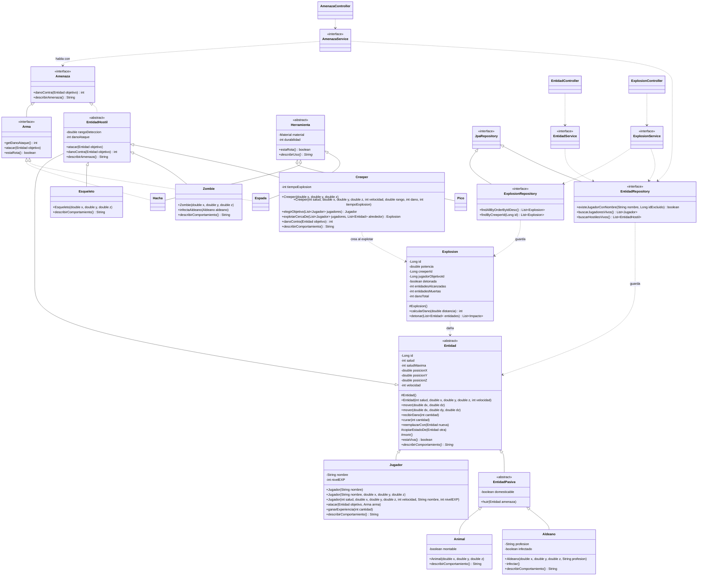
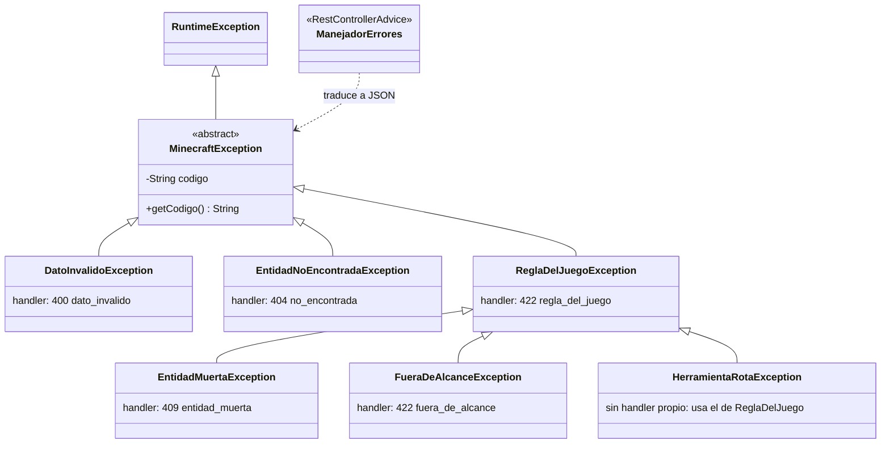

# ii-taller-git-2026

- **Nombre:** Irina Insfrán
- **GitHub:** [IrinaInsfran](https://github.com/IrinaInsfran)
- **Materia:** Lenguaje de Programación 3 — Sección F
- **Ejercicio:** POO-08 — CRUD REST, H2, reglas de juego y excepciones (dominio **Minecraft**)
- **Licencia:** [Apache License 2.0](LICENSE)
- **Bitácora de uso de IA:** [BITACORA.md](BITACORA.md)
- **Especificaciones (Classroom):** [docs/ESPECIFICACIONES-POO-08.md](docs/ESPECIFICACIONES-POO-08.md)
- **Colección Insomnia:** [insomnia/minecraft-poo08-insomnia.json](insomnia/minecraft-poo08-insomnia.json)

API REST en Spring Boot 4 / Java 21 que guarda el mundo de Minecraft en una base
**H2**: un CRUD de entidades (jugadores, mobs, aldeanos, animales), un protocolo
de dominio (`Amenaza`), una **simulación de explosiones de creeper** con dos
reglas del juego y una jerarquía de excepciones con un *handler* HTTP por tipo.

## Cómo arrancar

```bash
./mvnw spring-boot:run
```

Queda escuchando en `http://localhost:8080`. Los tests (82, con H2 en memoria
para no tocar `./data`):

```bash
./mvnw clean test
```

### Propiedades de H2 (`src/main/resources/application.properties`)

| Propiedad | Valor | Qué hace |
|---|---|---|
| `spring.datasource.url` | `jdbc:h2:file:./data/entidades` | La base es un archivo en `./data/`: los datos sobreviven a un reinicio. `data/` está en `.gitignore`. |
| `spring.datasource.driverClassName` | `org.h2.Driver` | El driver JDBC de H2 (dependencia `com.h2database:h2`). |
| `spring.datasource.username` / `password` | `sa` / vacío | Usuario por defecto de H2; sirve también para entrar a la consola. |
| `spring.jpa.hibernate.ddl-auto` | `update` | Hibernate crea las tablas que faltan y agrega columnas nuevas al arrancar, sin borrar lo guardado. |
| `spring.jpa.open-in-view` | `false` | Las entidades se cargan y se guardan dentro de los servicios (`@Transactional`), no mientras se arma el JSON. |
| `spring.h2.console.enabled` | `true` | Habilita la consola web de H2 (dependencia `spring-boot-h2console`). |
| `spring.h2.console.path` | `/h2-console` | Dónde se abre la consola. |
| `spring.h2.console.settings.web-allow-others` | `true` | Permite abrir la consola desde otra máquina (uso el navegador de Windows con la app en una VM). Solo para desarrollo. |

**Consola H2:** `http://localhost:8080/h2-console` → JDBC URL
`jdbc:h2:file:./data/entidades`, usuario `sa`, sin clave. Se ven las tablas
`ENTIDAD` (toda la familia, con la columna `TIPO_ENTIDAD`) y `EXPLOSION`.

## Paquetes

Siguen el [template de la cátedra](https://github.com/alefq/lp3-template-tp/tree/main/src/main/java/py/edu/uc/lp3)
(corrección de POO-06: antes el dominio estaba en `minecraft` y los controllers
en `web`).

| Paquete | Qué contiene |
|---|---|
| `py.edu.uc.lp3.domain` | Las clases del juego y sus reglas: `Entidad` y su familia, `Explosion`, `Herramienta`, las interfaces `Amenaza` y `Arma`. No conoce HTTP. |
| `py.edu.uc.lp3.exceptions` | La jerarquía `MinecraftException` (en el template, `lp3exceptions`). |
| `py.edu.uc.lp3.repository` | Interfaces de Spring Data: `EntidadRepository`, `ExplosionRepository`. Sin lógica. |
| `py.edu.uc.lp3.service` / `service.impl` | Orquestan: buscan en el repositorio, le piden al dominio que actúe y guardan. |
| `py.edu.uc.lp3.rest.controller` | Entrada HTTP y `ManejadorErrores`. |
| `py.edu.uc.lp3.constants` | `ApiPaths`, las URLs de la API. |
| `py.edu.uc.lp3.dto` | Lo que entra y sale como JSON (`EntidadRequest`, `EntidadResponse`...). Está aparte para que el dominio no tenga anotaciones de Jackson. |

## Endpoints

Base: `http://localhost:8080`. Todas las rutas están en `ApiPaths`.

| Verbo y URL | Qué hace | Éxito |
|---|---|---|
| `GET /` | La app vive. | 200 |
| `POST /api/minecraft/entidades` | Crea una entidad (el JSON trae `tipo`). | 201 + `Location` |
| `GET /api/minecraft/entidades` | Lista lo guardado en H2. | 200 |
| `GET /api/minecraft/entidades/{id}` | Una entidad, o 404. | 200 |
| `PUT /api/minecraft/entidades/{id}` | Reemplaza todos los datos. | 200 |
| `DELETE /api/minecraft/entidades/{id}` | La saca del mundo. | 204 |
| `GET /api/minecraft/entidades/{id}/amenazas[?arma=ESPADA&material=DIAMANTE]` | **Protocolo `Amenaza`**: quién le puede hacer daño a esa entidad y cuánto. | 200 |
| `GET /api/minecraft/comportamientos` | `describirComportamiento()` de cada entidad guardada (polimorfismo). | 200 |
| `POST /api/minecraft/explosiones` (`{"creeperId": 2}`) | **Simulación**: el creeper intenta explotar. | 201 + `Location` |
| `GET /api/minecraft/explosiones` | Historial de explosiones guardadas. | 200 |
| `GET /api/minecraft/explosiones/{id}` | Una explosión, o 404. | 200 |

Los endpoints `GET /api/minecraft/creeper` de POO-06 se quitaron: un `GET` que
"crea" algo que no se guarda contradice el CRUD; ahora un creeper se crea con
`POST /api/minecraft/entidades`.

### Ejemplo: crear con el constructor completo o con el sobrecargado

```bash
curl -X POST localhost:8080/api/minecraft/entidades -H "Content-Type: application/json" \
  -d '{"tipo":"JUGADOR","salud":20,"posicionX":0,"posicionY":64,"posicionZ":0,"velocidad":4,"nombre":"Steve","nivelEXP":5}'

curl -X POST localhost:8080/api/minecraft/entidades -H "Content-Type: application/json" \
  -d '{"tipo":"CREEPER","posicionX":3,"posicionY":64,"posicionZ":0}'
```

Si el JSON no trae ninguna estadística (salud, velocidad, rango, daño...), el
servicio usa el **constructor sobrecargado** de la clase hija con los valores
del juego; si trae alguna, usa el constructor completo y todas son obligatorias.

## Las dos reglas de la simulación

Participan tres clases persistidas: **`Creeper`**, **`Jugador`** y **`Explosion`**.

1. **Mecha corta** (`Creeper.elegirObjetivo`): un `Creeper` vivo solo enciende
   la mecha si hay un `Jugador` vivo a 3 bloques o menos, y apunta al más
   cercano; si no hay ninguno, no pasa nada (`FueraDeAlcanceException`).
2. **Onda expansiva** (`Explosion.detonar`): al explotar el `Creeper` muere y
   la `Explosion` (potencia 3, radio 6) le resta salud a **cada** entidad viva
   del radio, más cuanto más cerca esté (fórmula de Minecraft Java: 43 en el
   centro, 16 a 3 bloques, 0 a 6), y puede matarla.

`POST /api/minecraft/explosiones` llama a `Creeper.explotarCercaDe(jugadores, entidades)`,
que aplica las dos reglas. El servicio solo busca en el repositorio y guarda:
la salud nueva de cada entidad y una fila en `EXPLOSION` con quién la provocó,
cuántas entidades alcanzó y mató, y el daño total. Todo va en una transacción:
si una regla falla, no cambia nada.

```json
{
  "id": 1, "creeperId": 2, "jugadorObjetivoId": 1, "jugadorObjetivo": "Steve",
  "potencia": 3.0, "radio": 6.0,
  "entidadesAlcanzadas": 2, "entidadesMuertas": 1, "danoTotal": 40,
  "afectados": [
    {"id": 1, "tipo": "JUGADOR", "distancia": 3.0, "dano": 16, "saludRestante": 4, "murio": false},
    {"id": 3, "tipo": "ALDEANO", "distancia": 2.0, "dano": 24, "saludRestante": 0, "murio": true}
  ]
}
```

## Diagrama

Flechas: `<|--` **herencia**, `<|..` **implementación de interfaz**,
`..>` **uso** (el controller usa el servicio, el servicio usa el repositorio,
el repositorio guarda la entidad). La jerarquía de excepciones está en el
segundo diagrama. Los métodos con `*` son abstractos.



### Jerarquía de excepciones y handlers



| Excepción | HTTP | `error` | Cuándo (ejemplos de `codigo`) |
|---|---|---|---|
| `DatoInvalidoException` | 400 | `dato_invalido` | El dato no tiene sentido: `dato_invalido`, `campo_obligatorio`, `nombre_repetido`, `cambio_de_tipo` |
| `EntidadNoEncontradaException` | 404 | `no_encontrada` | El id no existe: `entidad_no_encontrada`, `explosion_no_encontrada` |
| `ReglaDelJuegoException` | 422 | `regla_del_juego` | Los datos están bien pero el juego no lo permite: `solo_creepers_explotan`, `excede_velocidad`, `aldeano_infectado`, `explosion_ya_detonada`... |
| `EntidadMuertaException` | 409 | `entidad_muerta` | Un muerto intenta actuar o se lo quiere editar |
| `FueraDeAlcanceException` | 422 | `fuera_de_alcance` | El objetivo está lejos (ningún jugador a 3 bloques del creeper) |

Todas las respuestas de error tienen la misma forma:

```json
{"error": "entidad_muerta", "codigo": "entidad_muerta", "mensaje": "Un Creeper muerto no puede explotar."}
```

## Qué hay que pensar — respuestas

**Recurso y verbo.** Los sustantivos son `entidades` (el CRUD) y `explosiones`
(la simulación). La URL nombra el recurso y el verbo dice la operación: no hay
URLs como `/crearCreeper` ni `/detonar`. Detonar es *crear una explosión*, por
eso es `POST /explosiones`.

**Identidad.** La clave es `id` (`Long`), la asigna H2 con
`@GeneratedValue(strategy = IDENTITY)`. El JSON de creación no la lleva
(`EntidadRequest` no tiene `id`); la respuesta sí, y el `Location` apunta a
`/api/minecraft/entidades/{id}`. `Entidad` no tiene `setId`: nadie fuera de
JPA puede cambiar la identidad.

**Herencia y tablas.** Elegí `SINGLE_TABLE`: toda la familia `Entidad` vive en
la tabla `ENTIDAD` y la columna `TIPO_ENTIDAD` (`@DiscriminatorColumn`) dice la
clase (`JUGADOR`, `CREEPER`...). En mi dominio la simulación necesita "todas
las entidades cerca de la explosión" sin importar el tipo: con una sola tabla
es un `SELECT` sin `JOIN`. El costo son columnas en `NULL` (un jugador no tiene
`tiempoExplosion`), aceptable con siete clases chicas. `JOINED` obligaría a
unir hasta tres tablas por entidad, y `TABLE_PER_CLASS` haría un `UNION` para
listar. En el JSON el subtipo va en el campo `tipo`, al crear y al listar.
No usé `@JsonTypeInfo` en `Entidad` a propósito: el dominio no tiene
anotaciones de Jackson y no tiene constructor vacío público ni setters para
que Jackson lo arme; el DTO `EntidadRequest` trae `tipo` y el servicio llama al
constructor de la clase hija, que valida. `TipoEntidad` es el `enum` que hace
de discriminador en el JSON.

**Interfaz y repositorio.** `EntidadRepository extends JpaRepository<Entidad, Long>`
es una interfaz; Spring genera la implementación. Los servicios dependen de ese
tipo y los controllers dependen de interfaces de servicio (`EntidadService`...),
no de clases concretas: si mañana cambio H2 por PostgreSQL, toco
`application.properties` y la dependencia del driver en `pom.xml`; el dominio,
los repositorios, los servicios y los controllers quedan quietos. Es la misma
idea que el protocolo de POO-07: quien llama conoce el mensaje, no quién lo
implementa.

**Protocolo del dominio.** `Amenaza` (`danoContra(Entidad)`,
`describirAmenaza()`): algo que le puede hacer daño a una entidad. La
implementan dos familias que no comparten padre: `EntidadHostil` (`Zombie`,
`Esqueleto`, y `Creeper`, que la sobreescribe porque su peligro es la
explosión) y `Arma` → `Espada`, `Hacha` (que son `Herramienta`). La usa
`GET /api/minecraft/entidades/{id}/amenazas`: `AmenazaServiceImpl` arma una
`List<Amenaza>` con los mobs hostiles guardados y, si se pide
`?arma=ESPADA&material=DIAMANTE`, una espada; `AmenazasResponse` le pregunta a
cada una sin saber de qué clase es.

**Ocultamiento.** Las reglas numéricas las sostienen los constructores y los
métodos del dominio (`salud > 0`, `velocidad >= 0`, posiciones finitas,
`curar` sin desbordar, `tiempoExplosion > 0`, `Math.addExact` en la
experiencia). El constructor vacío que pide JPA es `protected`: solo Hibernate
(por reflexión) y las clases hijas lo usan; el resto del código tiene que pasar
por un constructor de negocio. No hay setters públicos. El PUT no asigna
campos: construye una entidad nueva (pasa por las validaciones) y llama a
`reemplazarCon`, que además prohíbe cambiar de tipo o editar a un muerto.
En Insomnia, «POST ilegal (salud negativa)» devuelve 400 y el siguiente
«GET lista de entidades» muestra la misma cantidad que antes.

**PUT y PATCH.** Implementé `PUT`: reemplaza el recurso entero. Un campo
obligatorio omitido es un 400 (`campo_obligatorio`); los opcionales
(`nivelEXP`, `domesticable`, `montable`) toman su valor por defecto, no el
anterior. Si no se manda ninguna estadística se usan los valores del
constructor sobrecargado. No hay `PATCH`: un cambio parcial del estado del
juego (moverse, recibir daño) es un mensaje del dominio, no una edición.

**DELETE.** Borrar es sacar a la entidad del mundo (como un *despawn*), no
matarla: la fila se borra y la respuesta es 204; un `GET` posterior da 404.
Morir es otra cosa: lo decide el dominio (`recibirDano` → `morir()`) y la
entidad queda guardada con `viva: false`. Por eso `DELETE` no llama a un
mensaje del juego. Las explosiones guardan el `creeperId` como número y no como
relación: borrar al creeper no borra la historia.

**Dos reglas.** "Mecha corta" y "onda expansiva" (ver arriba). La explosión
cambia varios objetos a la vez: el creeper muere y cada entidad del radio
pierde salud. El recurso es `explosiones`; después de `POST
/api/minecraft/explosiones`, `GET /api/minecraft/entidades/{id}` muestra la
salud ya guardada y `GET /api/minecraft/explosiones` el registro de la
explosión.

**Excepciones.** La base es `MinecraftException` (abstracta) y las hijas
llevan el nombre de la pregunta que falla: `DatoInvalidoException` (¿el dato
tiene sentido?), `EntidadNoEncontradaException` (¿existe?) y
`ReglaDelJuegoException` (¿el juego lo permite?), con
`EntidadMuertaException`, `FueraDeAlcanceException` y
`HerramientaRotaException` como casos frecuentes de regla. Un id inexistente
(404) y una regla incumplida (422/409) son tipos distintos. Cada tipo tiene su
`@ExceptionHandler` en `ManejadorErrores`; Spring elige el más cercano, así
que `HerramientaRotaException` usa el de su padre. El JSON lleva `error`
(el tipo), `codigo` (el caso) y `mensaje`. Son **no comprobadas**
(`RuntimeException`): un dato inválido no se puede arreglar en el método que
llama, así que no tiene sentido obligar a cada servicio a declarar `throws`
para dejarla pasar; además `@Transactional` hace *rollback* solo con las no
comprobadas. Las lanza **el objeto del juego** (el constructor, `Creeper`,
`Explosion`); el controller no lanza nada.

## Sobrecarga y sobreescritura

### Sobrecarga (misma acción, otra lista de argumentos)

| Dónde | Firmas | Para qué |
|---|---|---|
| `Jugador` | `Jugador(nombre)`, `Jugador(nombre, x, y, z)`, `Jugador(salud, x, y, z, velocidad, nombre, nivelEXP)` | Un jugador nuevo aparece en el spawn (0, 64, 0) con salud 20; cada firma delega con `this(...)` en la siguiente. *(Corrección de POO-06.)* |
| `Zombie`, `Esqueleto` | `(x, y, z)` y la completa | Mob normal del juego en una posición. *(Corrección de POO-06.)* |
| `Aldeano` | `(x, y, z, profesion)` y la completa | La profesión sigue siendo obligatoria. *(Corrección de POO-06.)* |
| `Animal` | `(x, y, z)` y la completa | Animal de granja ni domesticable ni montable. *(Corrección de POO-06.)* |
| `Creeper` | `(x, y, z)` y la completa | Desde POO-06. |
| `Entidad.mover` | `mover(dx, dz)` y `mover(dx, dy, dz)` | Moverse en horizontal, delegando en la versión 3D. |

Todas las firmas cortas delegan en la completa, así que validan lo mismo. En la
API se ven con un `POST` sin estadísticas (`{"tipo":"ZOMBIE","posicionX":4,...}`).
El constructor vacío `protected` de cada clase es solo para JPA.

### Sobreescritura (la clase hija responde a su manera)

| Método | Dónde | Qué cambia |
|---|---|---|
| `describirComportamiento()` (abstracto en `Entidad`) | `Jugador`, `Creeper`, `Zombie`, `Esqueleto`, `Aldeano`, `Animal` | Cada tipo se describe; `GET /api/minecraft/comportamientos` recorre un `List<Entidad>` leído de H2 sin `if` por tipo. |
| `danoContra(Entidad)` (de `Amenaza`) | `EntidadHostil`, sobreescrito en `Creeper`; default en `Arma` | El zombie pega su daño si está en rango; el creeper amenaza con su explosión; una espada rota no hace daño. |
| `copiarEstadoDe(Entidad)` | cada clase de la familia | Cada clase copia sus campos y llama a `super`; lo usa el PUT. |
| `atacar(Entidad)` | `Creeper` | Llama a `super.atacar` y además explota. |
| `describirUso()` (abstracto en `Herramienta`) | `Espada`, `Hacha`, `Pico` | Cada herramienta cuenta para qué sirve. |

## Colección Insomnia

Archivo: [`insomnia/minecraft-poo08-insomnia.json`](insomnia/minecraft-poo08-insomnia.json).

1. Arrancar la app (`./mvnw spring-boot:run`). Para que los ids coincidan con
   los del entorno, conviene empezar con la base vacía: apagar la app, borrar
   la carpeta `data/` y volver a arrancar.
2. En Insomnia: **Import** (o *Create → Import From → File*) y elegir el
   archivo. Aparece la colección «Minecraft POO-08 (Irina Insfrán)».
3. Elegir el entorno **Local**. En el *Base Environment* están `baseUrl`
   (`http://localhost:8080`) y los ids que usan los pedidos: `jugadorId` 1,
   `creeperId` 2, `creeperLejosId` 5, `vacaId` 6. Si la base ya tenía datos,
   copiar los ids que devuelvan los `POST` a esas variables.
4. Recorrer las carpetas en orden:
   - **0. Estado** — `GET /`.
   - **1. CRUD** — crear Steve, un creeper, un aldeano, un zombie, un creeper
     lejos y una vaca; listar; leer por id; `PUT` (sube `nivelEXP` a 30 y se
     mantiene en el `GET`); `DELETE` de la vaca y `GET` → 404; `POST` ilegal → 400
     (y el `GET` de la lista no creció).
   - **2. Protocolo Amenaza** — amenazas sobre Steve, con y sin espada.
   - **3. Simulación** — `POST` de la explosión; después Steve tiene salud 4,
     el creeper y el aldeano `viva: false`, y la explosión está en el historial.
   - **4. Excepciones** — un pedido por tipo: `DatoInvalidoException` (400),
     `EntidadNoEncontradaException` (404), `ReglaDelJuegoException` (422,
     un jugador no explota), `EntidadMuertaException` (409, el creeper ya
     explotó) y `FueraDeAlcanceException` (422, nadie cerca del creeper lejano).
