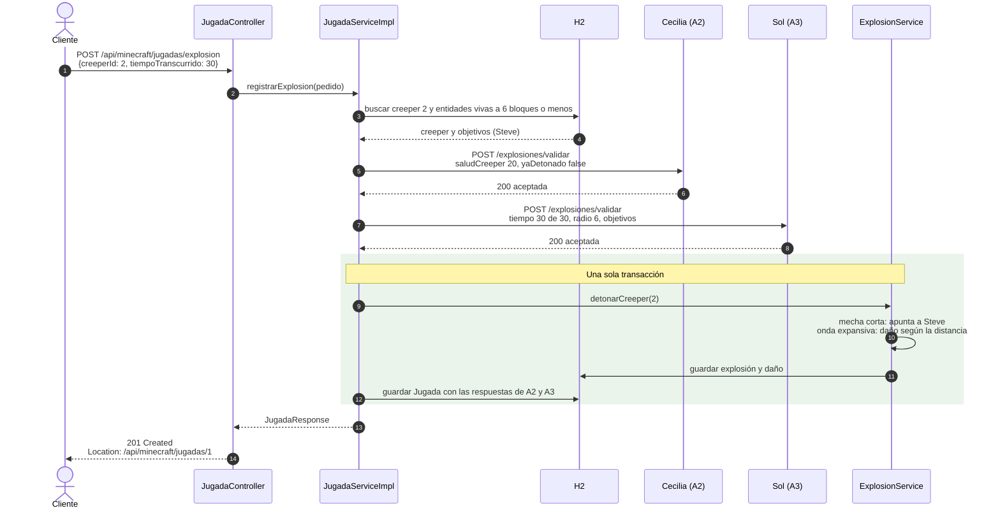
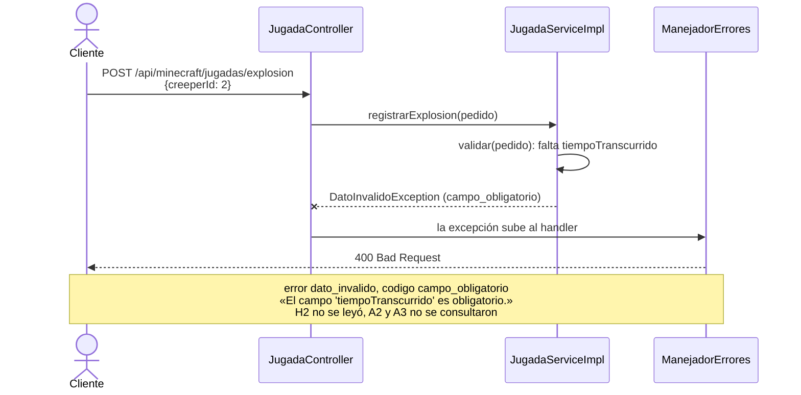
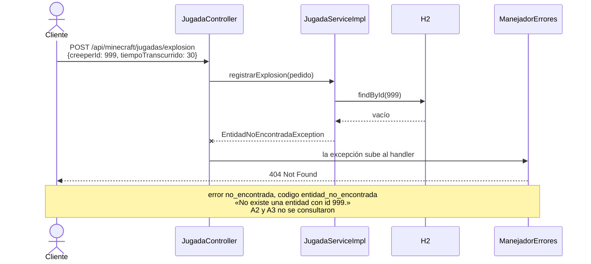
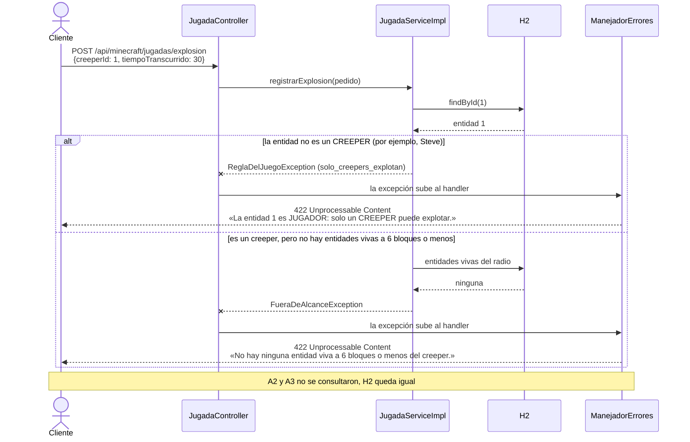
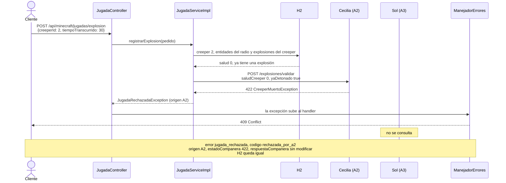
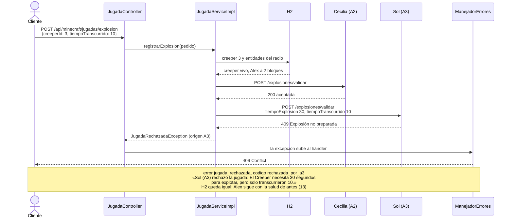
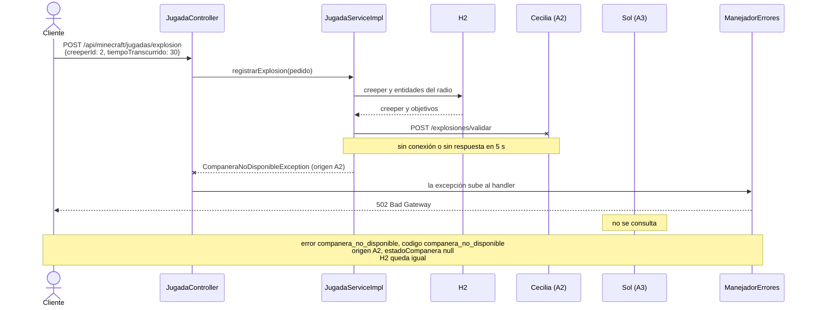
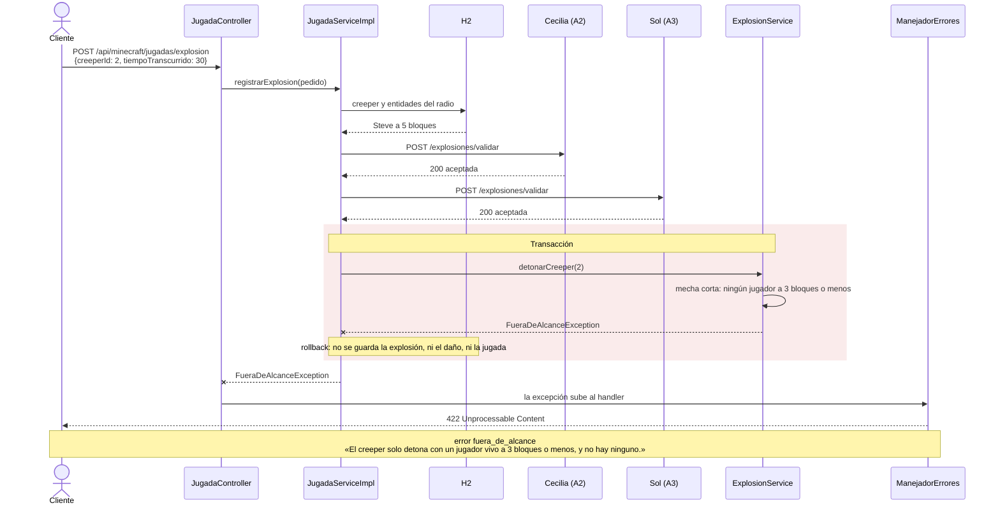

# Escenario POO-09: diagramas de secuencia

Caso de uso: **un creeper guardado intenta explotar y pide permiso a A2 y A3.**

`POST /api/minecraft/jugadas/explosion` con `{"creeperId": 2, "tiempoTranscurrido": 30}`.
La explosión se guarda en H2 solo si Cecilia (A2) y Sol (A3) aceptan y, después, mis
reglas (mecha corta y onda expansiva) también. Si algo falla, H2 queda igual.

| # | Caso | Código | ¿Consulta a A2 y A3? | ¿Cambia H2? |
|---|---|---|---|---|
| 1 | [Camino feliz](#1-camino-feliz-201-created) | **201** | Las dos | Sí: explosión, daño y jugada |
| 2 | [Falta un dato](#2-falta-un-dato-400-bad-request) | **400** `dato_invalido` | No | No |
| 3 | [El creeper no existe](#3-el-creeper-no-existe-404-not-found) | **404** `no_encontrada` | No | No |
| 4 | [No es un creeper o no hay nadie en el radio](#4-no-es-un-creeper-o-no-hay-nadie-en-el-radio-422) | **422** `regla_del_juego` / `fuera_de_alcance` | No | No |
| 5 | [Rechaza Cecilia (A2)](#5-rechaza-cecilia-a2-409-conflict) | **409** `rechazada_por_a2` | Solo A2 | No |
| 6 | [Rechaza Sol (A3)](#6-rechaza-sol-a3-409-conflict) | **409** `rechazada_por_a3` | Las dos | No |
| 7 | [Una compañera no responde](#7-una-compañera-no-responde-502-bad-gateway) | **502** `companera_no_disponible` | Hasta la que falla | No |
| 8 | [Las dos aceptan pero rechaza mi regla](#8-las-dos-aceptan-pero-rechaza-mi-regla-422-rollback) | **422** `fuera_de_alcance` | Las dos | No (rollback) |

Participantes:

- **Cliente:** Insomnia, `curl` o Swagger UI.
- **JugadaController:** recibe el pedido y arma el 201 con `Location`.
- **JugadaServiceImpl:** orquesta el escenario. Las llamadas HTTP van **fuera** de la transacción.
- **H2:** los repositorios `EntidadRepository`, `ExplosionRepository` y `JugadaRepository`.
- **Cecilia (A2):** `CeciReglasClient` → `POST /explosiones/validar` en `100.122.114.103:8083`.
- **Sol (A3):** `SolReglasClient` → `POST /explosiones/validar` en `100.87.131.50:8080`.
- **ExplosionService:** aplica mis reglas con `ReglasCreeperService` (mecha corta y onda expansiva).
- **ManejadorErrores:** traduce cada excepción a su código HTTP.

---

## 1. Camino feliz (201 Created)

Las dos compañeras aceptan y mis reglas encuentran un jugador vivo a 3 bloques o menos.



Respuesta (resumida; la completa está en
[`insomnia/respuestas-poo09/01-caso-feliz-201.json`](../insomnia/respuestas-poo09/01-caso-feliz-201.json)):

```json
{
  "id": 1, "creeperId": 2, "tiempoTranscurrido": 30,
  "a2": {"rol": "A2", "companera": "Cecilia", "estado": 200,
         "respuesta": {"aceptada": true, "mensaje": "El Creeper está vivo y todavía no detonó."}},
  "a3": {"rol": "A3", "companera": "Sol", "estado": 200,
         "respuesta": {"aceptada": true, "mensaje": "La explosión cumple el tiempo de detonación y todos los objetivos están dentro del radio."}},
  "explosion": {"id": 1, "jugadorObjetivo": "Steve", "radio": 6.0, "danoTotal": 41,
                "afectados": [{"tipo": "JUGADOR", "distancia": 2.0, "dano": 24, "murio": true}]}
}
```

---

## 2. Falta un dato (400 Bad Request)

El pedido no trae `tiempoTranscurrido` (o es negativo, o falta `creeperId`). Se corta antes
de leer la base y sin consultar a nadie.



---

## 3. El creeper no existe (404 Not Found)



---

## 4. No es un creeper o no hay nadie en el radio (422)

Las dos situaciones se detectan leyendo H2, antes de consultar a las compañeras: no hay una
jugada que valga la pena validar.



---

## 5. Rechaza Cecilia (A2) (409 Conflict)

El creeper 2 ya explotó en el caso feliz: está muerto y tiene una explosión guardada. Cecilia
lo rechaza y **a Sol no se le pregunta**, así el rechazo tiene un solo origen.



Respuesta real
([`02-rechazo-a2-ceci-409.json`](../insomnia/respuestas-poo09/02-rechazo-a2-ceci-409.json)):

```json
{
  "error": "jugada_rechazada", "codigo": "rechazada_por_a2",
  "origen": "A2", "companera": "Cecilia", "estadoCompanera": 422,
  "respuestaCompanera": {"status": 422, "error": "Unprocessable Entity",
                         "tipo": "CreeperMuertoException", "mensaje": "Creeper no puede detonar: está muerto."},
  "mensaje": "Cecilia (A2) rechazó la jugada: Creeper no puede detonar: está muerto. La jugada no se guardó."
}
```

---

## 6. Rechaza Sol (A3) (409 Conflict)

Cecilia acepta, pero la mecha se encendió hace 10 y el creeper necesita 30.



---

## 7. Una compañera no responde (502 Bad Gateway)

La API de una compañera está apagada, se vence el tiempo de espera (5 s, `COMPANERAS_TIMEOUT`)
o responde 5xx. Como no se sabe si su regla acepta, no se guarda nada. El ejemplo muestra a
Cecilia caída; si la que falla es Sol, el diagrama es igual pero después del 200 de Cecilia.



---

## 8. Las dos aceptan pero rechaza mi regla (422, rollback)

Steve está a 5 bloques: dentro del radio de la onda expansiva (6), así que hay jugada para
consultar y las compañeras aceptan, pero lejos para la mecha corta (3). Mi regla falla dentro
de la transacción y se deshace todo.



Si el creeper estuviera muerto y A2 igual lo aceptara, mi regla respondería **409**
`entidad_muerta` por el mismo camino. Con Cecilia como A2 eso no pasa: ella rechaza antes
(caso 5).

---

Cada caso está cubierto por un test de `JugadaControllerTest`:

| Caso | Test |
|---|---|
| 1 | `siLasDosAceptanSeGuardaLaJugadaYLaExplosion` |
| 2, 3, 4 | `datosFaltantesOInvalidos`, `sinNadieEnElRadioNoSeConsultaANadie` |
| 5 | `siCeciRechazaNoSeConsultaASolYNoCambiaNada` |
| 6 | `siSolRechazaNoCambiaNada` |
| 7 | `siUnaCompaneraNoRespondeDevuelve502` |
| 8 | `siLasDosAceptanPeroMiReglaRechazaSeDeshaceTodo` |
