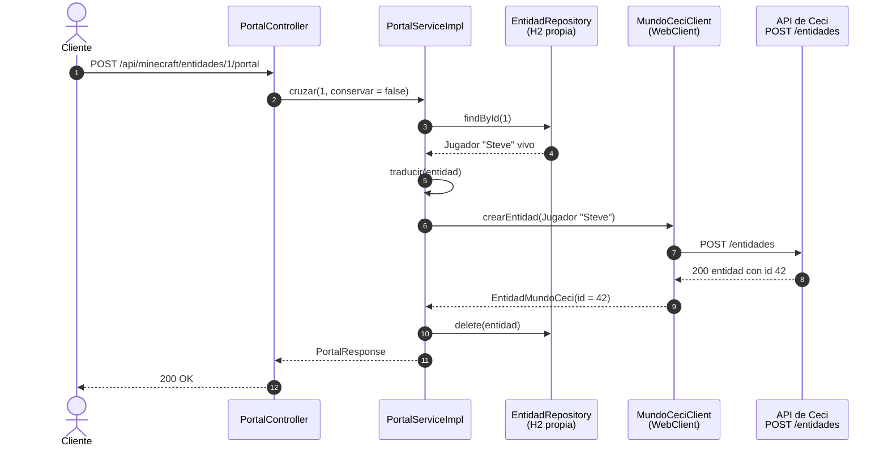
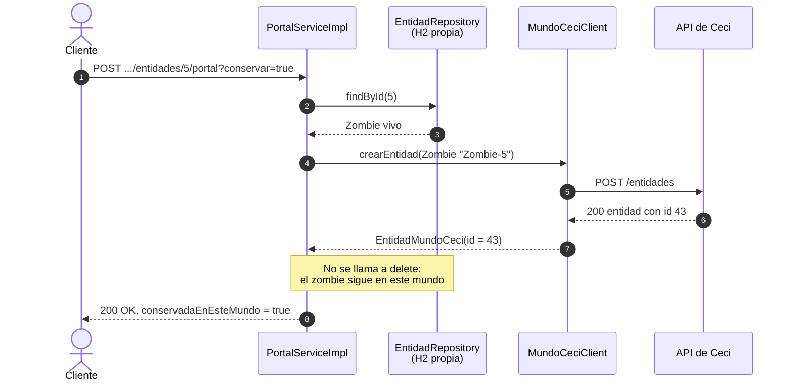
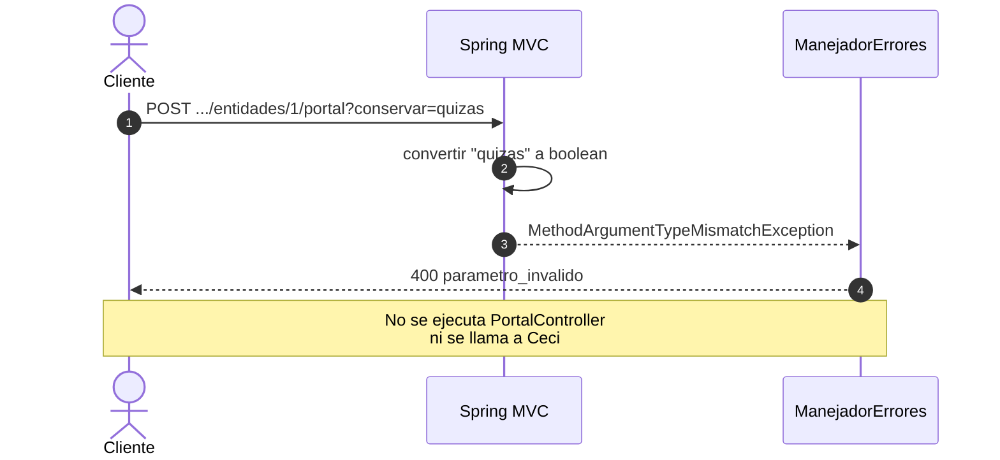
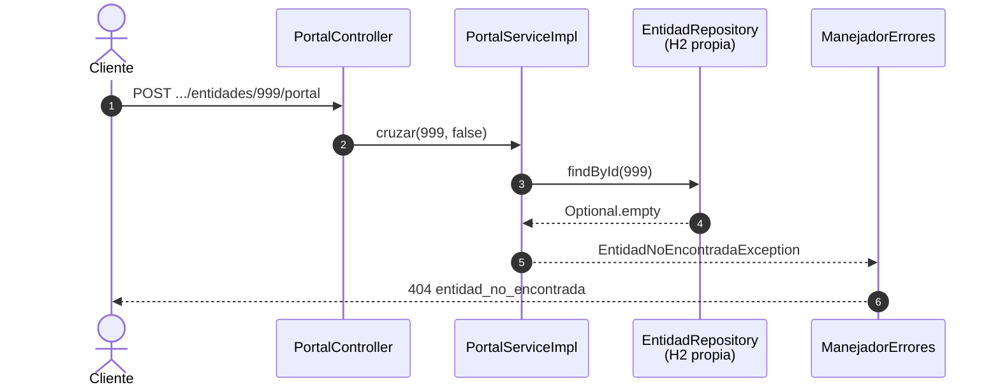
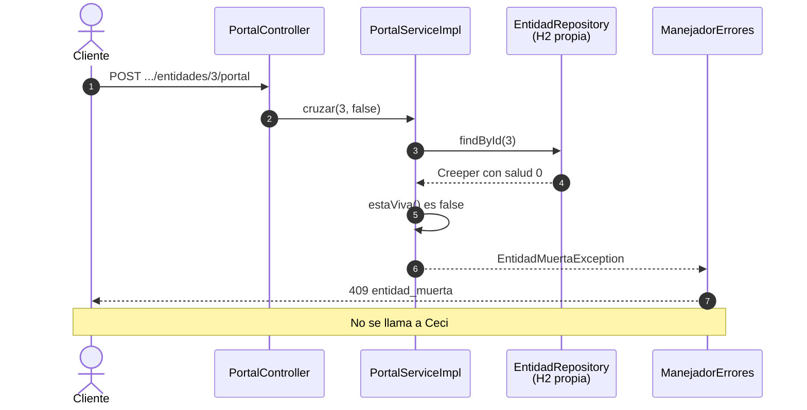
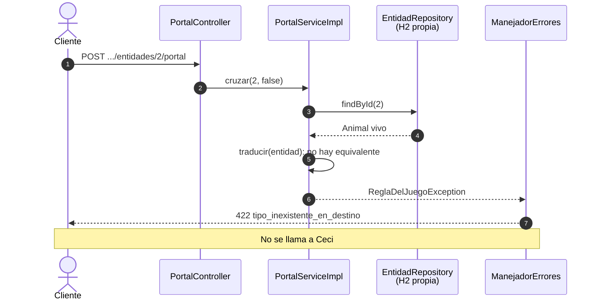
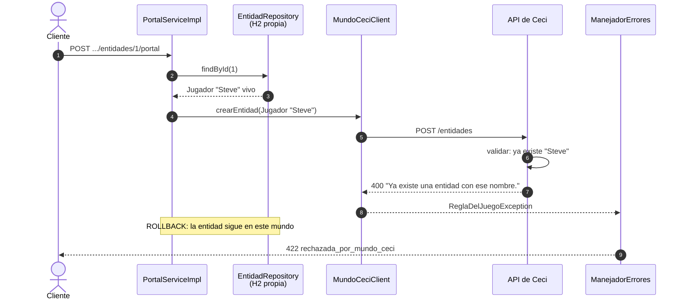
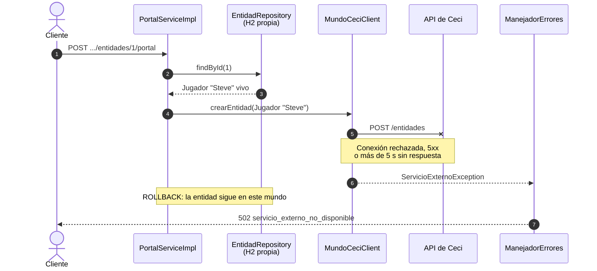
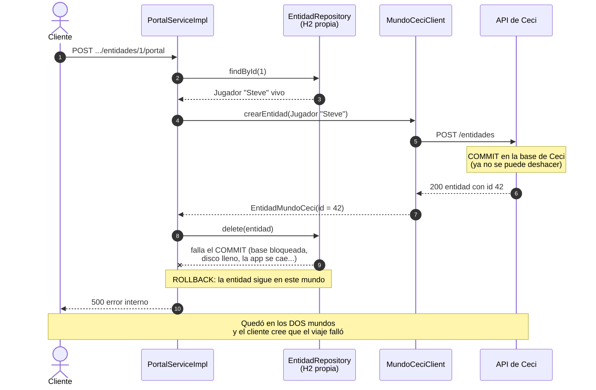
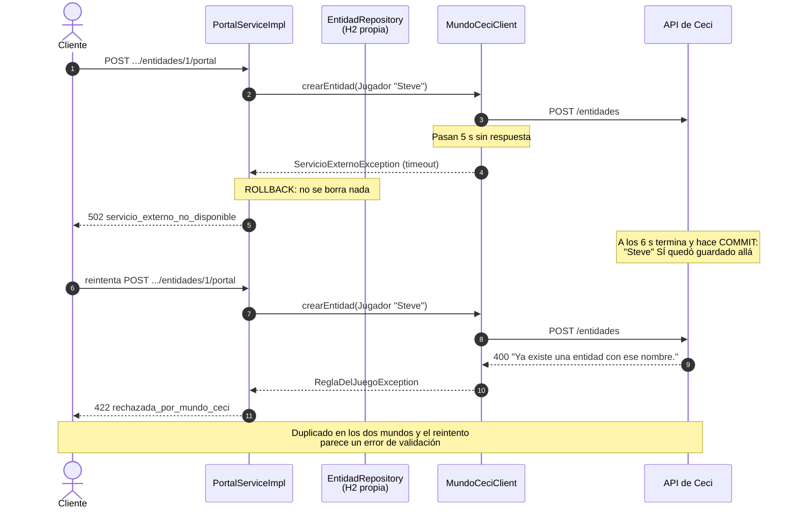

# Caso de uso: Portal al mundo de Ceci

`POST /api/minecraft/entidades/{id}/portal[?conservar=true]`

Una entidad de este mundo viaja al mundo Minecraft de Ceci (otro proyecto del
taller, URL en `mundo-ceci.base-url` / variable `MUNDO_CECI_URL`). Cada
proyecto pone sus reglas:

| Quién | Regla |
|---|---|
| Este proyecto | La entidad tiene que existir, estar viva y ser JUGADOR, ZOMBIE o CREEPER. |
| Mundo de Ceci | Sus validaciones del CRUD: nombre único, vida ≤ vidaMaxima, nivel y experiencia no negativos. |
| Este proyecto | Si el otro mundo la acepta y no se pidió `conservar=true`, la entidad sale de este mundo. |

Clases que participan: `PortalController` → `PortalServiceImpl` →
`EntidadRepository` (H2 propia) y `MundoCeciClient` (WebClient) →
API de Ceci (`POST /entidades`, con su propia H2).

## Índice de respuestas

| Código | Caso | ¿Se llama a Ceci? | ¿La entidad sigue acá? |
|---|---|---|---|
| **200** | [Camino feliz: la entidad viaja](#200--camino-feliz-la-entidad-viaja) | Sí | No |
| **200** | [Variante: `conservar=true`, se copia](#200--variante-conservartrue-se-copia) | Sí | Sí |
| **400** | [Parámetro inválido](#400--parámetro-inválido) | No | Sí |
| **404** | [La entidad no existe](#404--la-entidad-no-existe) | No | — |
| **409** | [La entidad está muerta](#409--la-entidad-está-muerta) | No | Sí |
| **422** | [El tipo no existe en el mundo de Ceci](#422--el-tipo-no-existe-en-el-mundo-de-ceci) | No | Sí |
| **422** | [El mundo de Ceci la rechaza](#422--el-mundo-de-ceci-la-rechaza) | Sí | Sí |
| **502** | [El mundo de Ceci falla o no responde](#502--el-mundo-de-ceci-falla-o-no-responde) | Sí | Sí |
| **500** | [No cubierto A: falla el commit propio](#no-cubierto-a--500-falla-el-commit-propio) | Sí | Sí, **y también allá** |
| **502 → 422** | [No cubierto B: timeout, pero Ceci la guardó](#no-cubierto-b--502-y-después-422-timeout-pero-ceci-la-guardó) | Sí | Sí, **y también allá** |

Todos los errores responden con el mismo cuerpo `ErrorResponse`:
`{"error": "...", "codigo": "...", "mensaje": "..."}`.

---

## 200 · Camino feliz: la entidad viaja



Respuesta:

```json
{
  "entidadId": 1,
  "tipo": "JUGADOR",
  "conservadaEnEsteMundo": false,
  "mundoDestino": "http://localhost:8081",
  "entidadEnDestino": {
    "id": 42, "tipo": "Jugador", "nombre": "Steve",
    "vida": 20, "vidaMaxima": 20, "x": 1.0, "y": 64.0, "z": 2.0,
    "nivel": 3, "experiencia": 0
  }
}
```

`traducir` convierte salud → vida, saludMaxima → vidaMaxima y nivelEXP →
nivel. Los mobs, que no tienen nombre en este proyecto, viajan como
`Zombie-{id}` o `Creeper-{id}`.

## 200 · Variante: `conservar=true`, se copia

Igual al camino feliz, pero la entidad no se borra: queda en los dos mundos.



## 400 · Parámetro inválido

El `id` no es un número o `conservar` no es `true`/`false`. Spring rechaza
el pedido antes de llegar al controller.



```json
{"error": "dato_invalido", "codigo": "parametro_invalido",
 "mensaje": "El valor 'quizas' no sirve para el parámetro 'conservar'."}
```

## 404 · La entidad no existe



```json
{"error": "no_encontrada", "codigo": "entidad_no_encontrada",
 "mensaje": "No existe una entidad con id 999."}
```

## 409 · La entidad está muerta

Regla de este proyecto: un muerto no cruza el portal.



```json
{"error": "entidad_muerta", "codigo": "entidad_muerta",
 "mensaje": "La entidad 3 está muerta: un muerto no puede cruzar el portal."}
```

## 422 · El tipo no existe en el mundo de Ceci

Regla de este proyecto: en el mundo de Ceci solo hay Jugador, Zombie y
Creeper, así que ESQUELETO, ALDEANO y ANIMAL no pueden viajar.



```json
{"error": "regla_del_juego", "codigo": "tipo_inexistente_en_destino",
 "mensaje": "Un ANIMAL no puede cruzar: en el mundo de Ceci solo existen JUGADOR, ZOMBIE y CREEPER."}
```

## 422 · El mundo de Ceci la rechaza

Regla del otro proyecto: sus validaciones dicen que no (por ejemplo, ya hay
una entidad con ese nombre). Ceci responde 400 y acá se traduce a 422, porque
los datos del pedido estaban bien, pero el otro mundo no permite la acción.



```json
{"error": "regla_del_juego", "codigo": "rechazada_por_mundo_ceci",
 "mensaje": "El mundo de Ceci rechazó la entidad: Ya existe una entidad con ese nombre."}
```

## 502 · El mundo de Ceci falla o no responde

La app de Ceci está apagada, responde con 5xx o tarda más de
`mundo-ceci.timeout` (5 s).



```json
{"error": "servicio_externo", "codigo": "servicio_externo_no_disponible",
 "mensaje": "No se pudo consultar el mundo de Ceci: <detalle del error de conexión>"}
```

---

## Casos no cubiertos: la entidad queda en los dos mundos

El `POST` a Ceci se confirma en **su** base apenas responde, pero el borrado
en la base propia recién se confirma al final de la transacción. Son dos bases
con dos transacciones independientes: si algo falla entre esos dos momentos,
no hay forma de deshacer lo que ya hizo Ceci.

### No cubierto A · 500: falla el commit propio



### No cubierto B · 502 y después 422: timeout, pero Ceci la guardó



### Por qué el orden actual es el menos malo

Primero se crea en el mundo de Ceci y después se borra acá. Al revés (borrar
primero, crear después), si Ceci rechaza o no responde, la entidad se
**pierde en los dos mundos**. Con el orden actual, el peor caso es un
**duplicado**, nunca una pérdida.

### Cómo se podría cubrir (pendiente)

1. **Compensación (patrón Saga):** si falla el borrado o el commit propio,
   llamar a `DELETE /entidades/{id}` en Ceci para deshacer la creación.
2. **Verificación ante timeout:** antes de responder 502, consultar
   `GET /entidades/nombre/{nombre}` en Ceci. Si ya existe, el viaje ocurrió y
   se termina de borrar acá.
3. **Patrón outbox:** registrar el viaje pendiente en la base propia y que
   un proceso aparte lo complete o lo revierta. Es la solución de sistemas
   reales, pero es demasiado para este taller.
